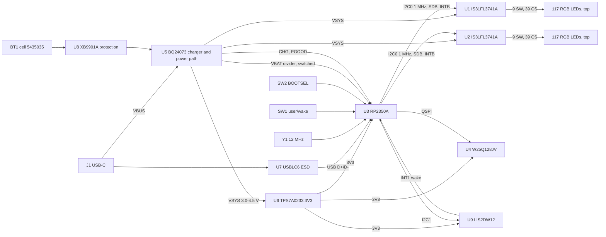

# Architecture

## GPIO plan (RP2350A, confirmed in the schematic)

| GPIO | Use | Note |
|---|---|---|
| 2, 3 | I2C1 SDA, SCL to U9 | 400 kHz, 4.7 kΩ pull-ups to 3V3 |
| 4, 5 | I2C0 SDA, SCL to U1, U2 | 1 MHz, 1 kΩ pull-ups to 3V3, 12 mA drive |
| 6, 7 | SDB1, SDB2 | 100 kΩ pull-down at each driver |
| 8, 9 | INTB1, INTB2 | 100 kΩ pull-ups to 3V3 |
| 10 | ACC_INT | power-up wake source |
| 11 | SW1 | power-up wake source, 1 kΩ series |
| 12, 13 | CHG, PGOOD | open drain, 100 kΩ pull-ups to 3V3 |
| 14 | VBAT_EN | Switches the divider via Q1; default pull-down keeps it off |
| 26 | VBAT_SENSE | ADC0, 100 kΩ / 100 kΩ with 100 nF |
| others | test pads where they fit | |
