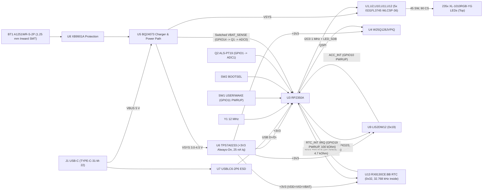

# Gate 1: architecture and datasheet audit (`round-pendant-f-usbc-rtc`)

Status: **passed**
Parent variant: `round-pendant-f-usbc` ([phase4.md](../round-pendant-f-usbc/phase4.md), [phase10.md](../round-pendant-f-usbc/phase10.md)); unchanged parent requirements & audits in [phase0.md](../phase0.md) and [phase1.md](../phase1.md).
New / updated part audits:
- `U13` (`Seiko Epson RX8130CE:BB` I²C RTC with built-in `32.768 kHz` crystal): [design/parts/rtc-rx8130ce.md](../../parts/rtc-rx8130ce.md)
- `BT1` (`CJT A1251WR-S-2P` / `Molex 53261-0271` right-angle `1.25 mm` 2P SMT battery header): [design/parts/parallelogram-io.md](../../parts/parallelogram-io.md) §2

---

## 1. Architecture & Block Diagram (`round-pendant-f-usbc-rtc`)



### GPIO & Bus Delta vs. `round-pendant-f-usbc`
- **`I2C1` (`GPIO2 = ACC_SDA`, `GPIO3 = ACC_SCL`, `4.7 kΩ` pull-ups `R19/R20`):** Now shared between `U9` (`LIS2DW12` @ `0x19`) and `U13` (`RX8130CE:BB` @ `0x32`). Keeping `U13` off `1 MHz` `I2C0` preserves full `1 MHz` LED matrix bandwidth while respecting `RX8130CE`'s `400 kHz` Fast-Mode ceiling (`t_r,10-90% = 185.9 ns < 300 ns`).
- **`GPIO19` (`U3` Pin 31, `RTC_INT`):** Active-low `/IRQ` open-drain alarm/wakeup-timer output from `U13` Pin 6, pulled to `+3V3` by external `R32 = 100 kΩ` (`0.00 nA` idle leakage; `RP2350` internal pulls disabled `PUE=0, PDE=0` to avoid `RP2350-E9`; drives `POWMAN` `PWRUP2` deep-sleep wake).

---

## 2. Checklist (`references/datasheet-audit.md` §Gate checklist)
- [x] **Block diagram exists and every block maps to parts:** Mermaid diagram above (`Power`, `MCU` incl. `Accelerometer` + `Real-Time Clock` + `ALS`, `Driver 1..5`).
- [x] **Every non-trivial part has an audit file with datasheet in `datasheets/`:** `rx8130ce.pdf` + `rx8130ce-app-manual.pdf` (`ETM50E-10`) audited in [rtc-rx8130ce.md](../../parts/rtc-rx8130ce.md); `cjt-a1251.pdf` + `molex-53261-0271.pdf` audited in [parallelogram-io.md](../../parts/parallelogram-io.md) §2.
- [x] **Every abs max checked against worst case from `intent.md`:** `RX8130CE` `-0.3..+6.5 V` vs `+3.366 V` max (`1.93×` margin), `T_reflow ≤ +260 °C` vs `≤ 250 °C` (`B.Cu`) / `≤ 245 °C` (`F.Cu`); `A1251WR-S-2P` `1.0 A / 125 V` vs `0.34 A / 4.25 V` (`2.94×` current margin).
- [x] **Every chosen value has a shown calculation:** `I_DD = 1.50 µA` (`FSEL1:0 = 11b`), `I2C1` `t_r = 185.9 ns < 300 ns` (`C_bus ≈ 18 pF`, `4.7 kΩ`), `R32 = 100 kΩ` (`0 nA` idle, `33 µA` during `7.57 ms` pulse), room/worn frequency drift (`+5 ± 23 ppm`, `-2.24 ppm` @ `+33 °C`).
- [x] **MLCC derating checked:** `C75` (`100 nF 16 V X7R` `C1525` @ `3.3 V` -> `~84 nF` eff) and `C76` (`1.0 µF 10 V X5R` `C52923` @ `3.3 V` -> `~0.68 µF` eff vs `0.1 µF` single-rail Circuit EX7 requirement).
- [x] **Every footprint matches the exact package suffix of the MPN:** `RX8130CE:BB` (`CE` `3.2 × 2.5 × 1.0 mm` 10-pad ceramic LCC, non-uniform `±1.55 / ±0.70 / 0.00 mm` row spacing verified against `ETM50E-10` Fig. 9 & EasyEDA `C1542426`); `A1251WR-S-2P` (`1.25 mm` 90° SMT wafer verified against `cjt-a1251.pdf` p. 5).
- [x] **Sourcing confirmed with `jlc_parts.py show` output and date; no new part flagged:**
  ```text
  C1542426 RX8130CE:BB (EPSON, SMD-10P): extended, JLC stock 2242, lifecycle normal, checked 2026-11-09
  C225111 A1251WR-S-2P (CJT(Changjiang Connectors), SMD,P=1.25mm,Surface Mount,Right Angle): extended, JLC stock 74989, lifecycle normal, checked 2026-11-09
  C1525 CL05B104KO5NNNC (Samsung Electro-Mechanics, 0402): basic, JLC stock 33472164, lifecycle normal, checked 2026-11-09
  C52923 CL05A105KA5NQNC (Samsung Electro-Mechanics, 0402): basic, JLC stock 11367807, lifecycle normal, checked 2026-11-09
  C25741 0402WGF1003TCE (UNI-ROYAL, 0402): basic, JLC stock 8563379, lifecycle normal, checked 2026-11-09
  ```
- [x] **Every datasheet listed in `design/datasheets/sources.csv`:** `cjt-a1251.pdf,C225111`, `rx8130ce.pdf,C1542426`, `rx8130ce-app-manual.pdf,https://download.epsondevice.com/td/pdf/app/RX8130CE_en.pdf`.
