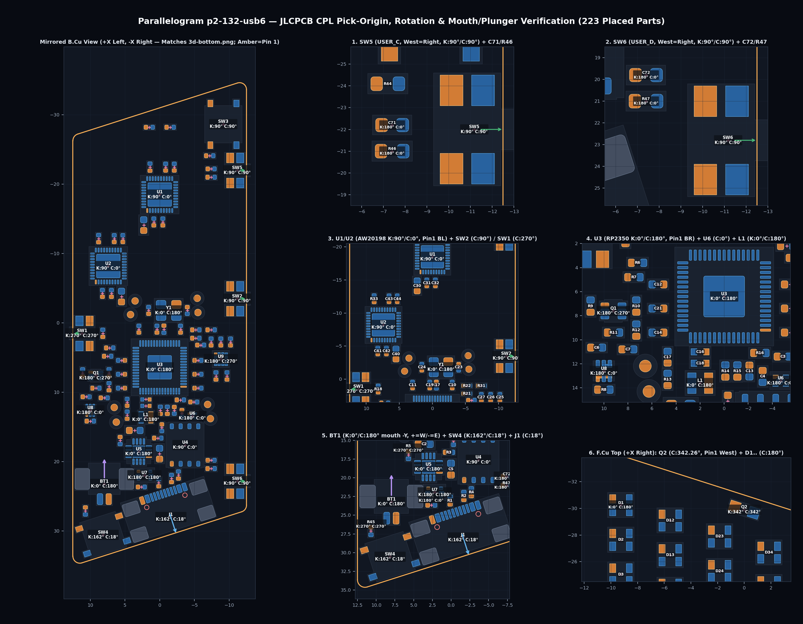
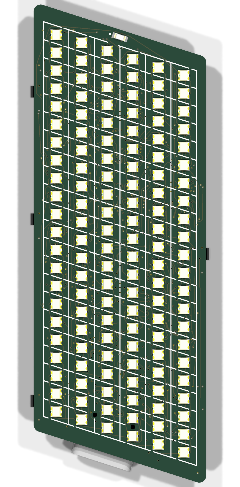

**Gate 10 — final release (`parallelogram-p2-132-usb6`, `Rev P1U6`).** Complete 4-layer fab & PCBA package in `hw/parallelogram/p2-132-usb6/fab/` (`JLC04161H-7628` `1.6 mm` FR-4, `ENIG 1U"`, mandatory `POFV = Yes` Type VII epoxy-filled & capped vias [`~$70–$95` 4L bare-PCB lot surcharge]): `0` ERC violations, `0` DRC errors/warnings, `0` unconnected nets (`5,416` tracks, `719` vias), `0` `copper_audit` / `pad_joints` / non-LED `silk_check` defects, `100%` collision-free `assembly-{top,bottom}.pdf`, `$13.26/bd` @ qty 10 (`41/41` BOM rows in live JLCPCB PCBA stock).

**Key release checks verified:**

- **CPL rotations & pick-origins (`223` parts, `0.00°` error):** Verified in Mirrored-Bottom `cpl-overlay.png` against `3d-bottom.png`: rotated **`BT1`** sits at `(107.9700mm, -123.2000mm)`, `Rotation = 180.00°` (`+0.20 mm` `c_origin` Y-shift, mouth facing straight `-Y` North, `+` West / `-` East — check off-the-shelf LiPo harness polarity with DMM before mating); bezel-aligned **`SW4`** sits at `(108.1500mm, -130.5500mm)`, `Rotation = 17.74°` (matching `J1`'s `17.74°`); West-edge **`SW5`/`SW6`** sit at `Mid X = 88.8250mm`, `Rotation = 90.00°` (matching `SW2`).
- **Power, SI, thermal & button simulation (`design/sim/p2-132-usb6/`):** Full `VSYS` + battery-path nodal solve gives **`-4.64 mV` `VSYS` drop at `U6.4`** and **`V(U6.4) = 3.375 V ≥ 3.355 V` worst-case at `VBAT = 3.50 V`** at `300 mA` burst (`GCC ≤ 0x74`, mandatory analog `GCC` scaling); still-air wearable ceiling is **`0.54 W` (`GCC ≤ 0x40`, `43.0 °C < 45 °C`)** with `ADC4` foldback on `0.95 W` bursts; `1 kΩ + 100 nF 50 V X7R` (`C307331`) + `≥ 20 ms` firmware debounce covers `18.83 ms` slow-corner `EVQP7J01P` release and `8 kV` ESD flashover (`36.35 V` margin).
- **Sibling variant isolation (`run_bytecheck.py`):** Parent `p2-132-usb` (`225/225` footprints) and `p1-66-usb` (`152/152` footprints) plus all `40` shared library/DRU/table files verified `100%` untouched (`0` mismatches).
