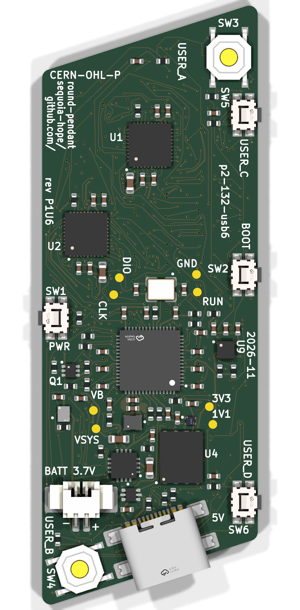
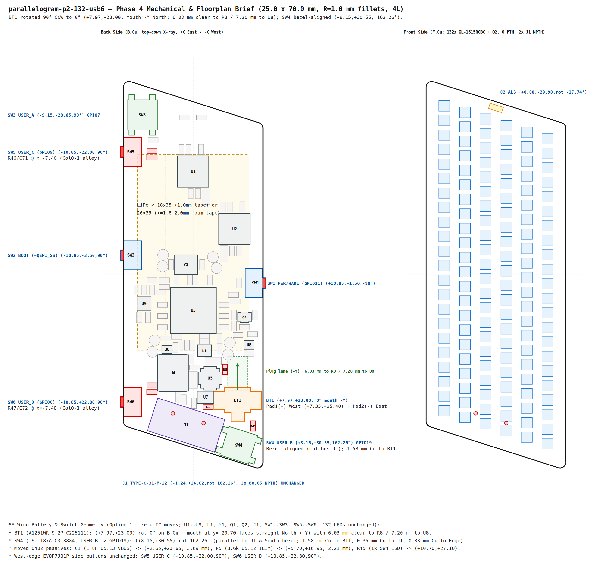

**Gate 4 — mechanical and layout brief (`parallelogram-p2-132-usb6`).** Rotates the back-side LiPo battery connector `BT1` (`CJT A1251WR-S-2P`, `C225111`) `90°` counter-clockwise to face straight North toward board center and shifts the South-East wing push button `SW4` (`USER_B`) deeper into the corner parallel to `J1`, while keeping **every IC (`U1..U9`, `L1`, `Y1`, `Q1`, `Q2`), USB-C `J1`, side buttons `SW1/SW2/SW5/SW6`, NW button `SW3`, and all `132` front LEDs (`D1..D132`) 100% unmoved**.

**What changed in the South-East wing (Option 1 — "move the switch"):**

- **`BT1` (`A1251WR-S-2P`) rotated `90°` CCW to `(+7.97, +23.00) mm`, `0°`:** Its mating mouth (`y = +20.70 mm`) now faces straight North (`-Y`) toward the LiPo pocket with **`6.03 mm` unobstructed plug-entry runway** to `0402` `R8` (`7.20 mm` to `U8`), replacing the old `1.28 mm` tilted-plug gap in front of `U5`. Rear signal pads sit at `Pad 1` (`+` `VBAT`) West `(+7.345, +25.400)` and `Pad 2` (`-` `BAT_N`) East `(+8.595, +25.400)`, clearly marked `+`, `-`, and `BATT 3.7V` on `B.SilkS` (plus all `8/8` test points labeled on `B.SilkS`).
- **`SW4` (`TS-1187A-B-A-B`, `USER_B` -> `GPIO19`) bezel-aligned at `(+8.15, +30.55) mm`, `162.26°`:** Nestled into the acute SE corner at the exact same `17.74°` bezel angle as `J1`, clearing `BT1` copper by `1.584 mm`, `J1` copper by `0.355 mm`, and the South/East board edges by `0.331 mm`.
- **Three `0402` passives & two test pads nudged (`0` IC moves):** `C1` (`1 µF` `VBUS` decoupler -> `(+2.65, +23.65)`, `3.69 mm` from `U5.13`), `R5` (`3.6 kΩ` `ILIM` -> `(+5.70, +16.95)`, West of the plug lane), and `R45` (`1 kΩ` `SW4` ESD -> `(+10.70, +27.10)`), plus `≤ 0.14 mm` alignment nudges on bare pads `TP1` (`VSYS`) and `TP3` (`VBAT`).
- **West-edge side buttons (`SW5` `USER_C` -> `GPIO9`, `SW6` `USER_D` -> `GPIO0`) & LiPo standoff:** Peg-less `EVQP7J01P` switches at `(-10.85, -22.00)` and `(-10.85, +22.80)` (`0.45 mm` rest overhang, `0.25 mm` proud at `0.20 mm` full stroke; paired with `1 kΩ` + `100 nF 50 V X7R` `C307331`; use `≤ 18.0 mm`-wide LiPo such as `501035` on `1.0 mm` tape or `≥ 1.8–2.0 mm` double-layer foam tape for a `20 × 35 mm` cell over `1.55 mm` max switch bodies).
