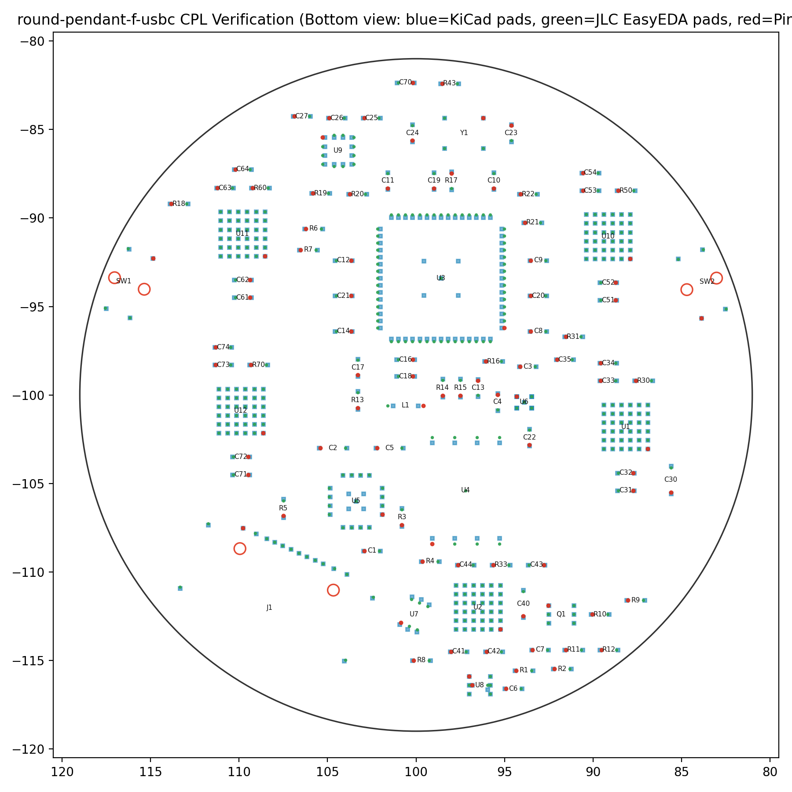
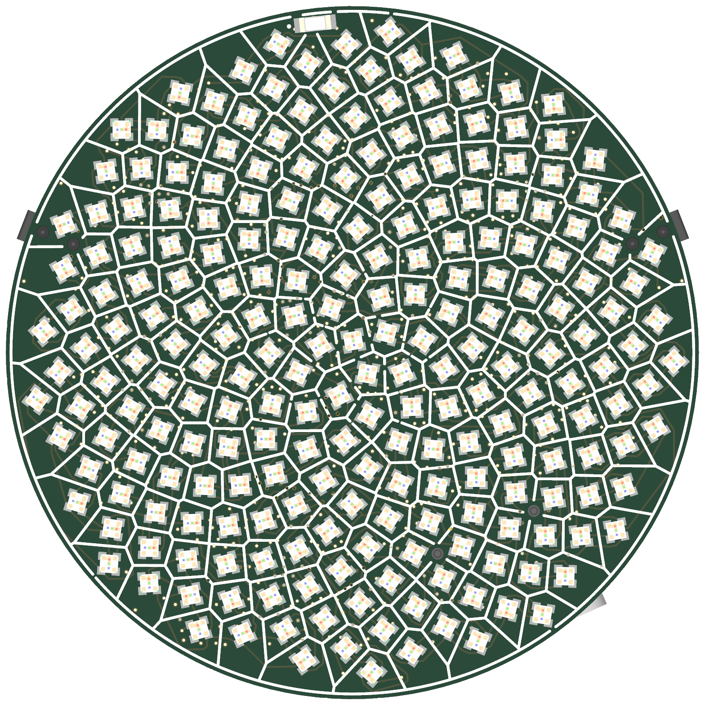

**Gate 10 — final release (`round-pendant-f-usbc`).** Complete fab package in `hw/round-pendant/f-usbc/fab/` (`JLC08101H-1080` 8-layer `1.0 mm` ENIG + POFV): `0` ERC errors, `0` DRC errors/warnings, `0` unconnected, `0` copper/pad-joint/silk errors, intact `GND`/`VSYS`/`+3V3`/`+1V1` planes (`dPcs = +0` vs F), `$26.62/bd` @ qty 10 (`+$0.36/bd` over Variant F).

**Key release checks verified:**

- **`J1` CPL rotation on `B.Cu`:** `Mid = (108.2778mm, -112.0309mm)`, `Rotation = 336.05°` (`0.077 mm` RMS pad-for-pad match across all `16` SMD pads against EasyEDA `C530612`).
- **Split drill files & NPTH review:** `round-pendant-PTH.drl` (`886` epoxy-filled POFV vias) and `round-pendant-NPTH.drl` (`6` unplated peg holes: `2× Ø0.65 mm` `J1` + `4× Ø0.70 mm` `SW1/SW2`), verified in `gerbonara` with `≥ 0.201 mm` copper clearance across all 8 layers.
- **Live JLCPCB PCBA stock:** `31/33` BOM lines are in immediate JLCPCB SMT stock (`C530612 J1 = 2,410`, `C42411119 L1 = 1,357` restocked!). Only Variant F's two inherited Global-Sourcing parts (`C2678907 IS31FL3745` WLCSP-36 driver and `C146233 ALS-PT19` sensor, or local JLC drop-in `C47416518`) need Global Sourcing / pre-order.
