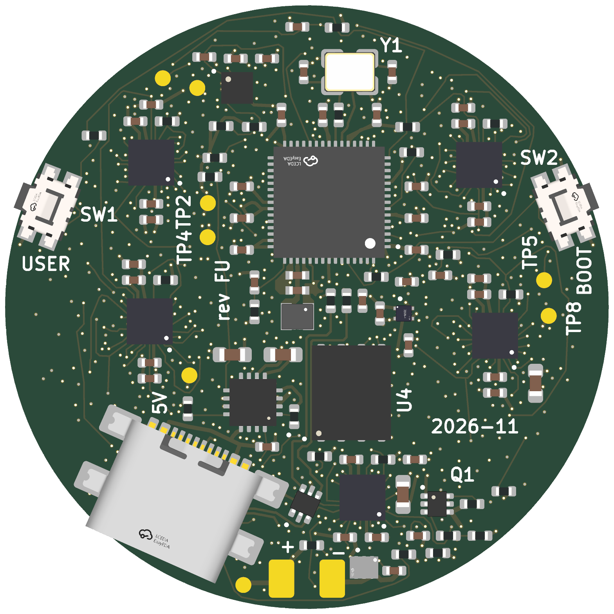
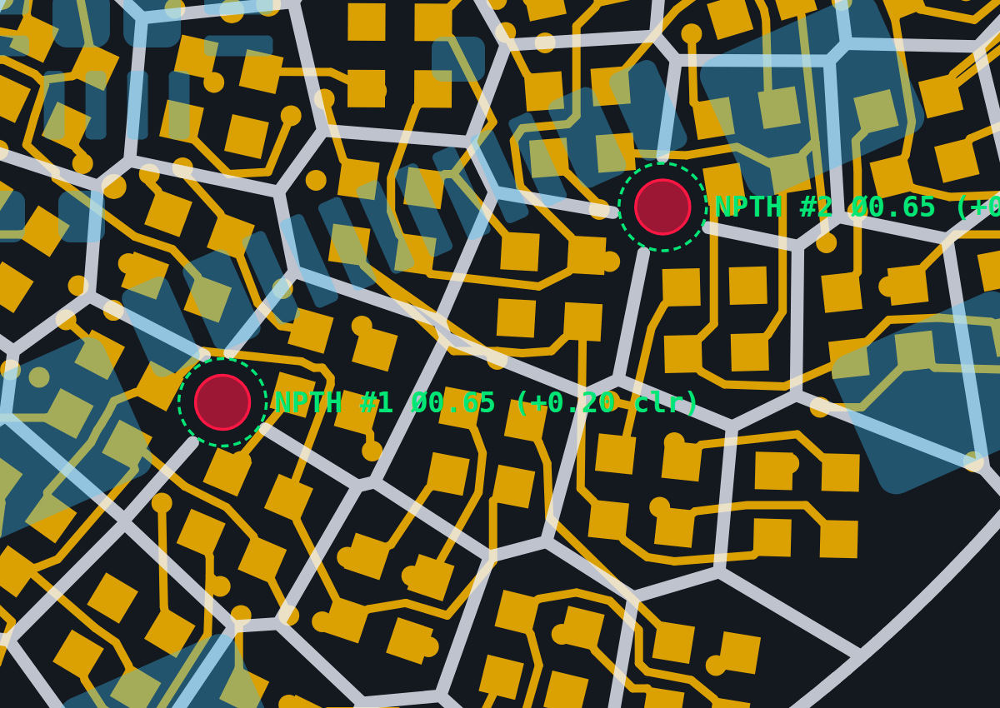

**Gate 4 — mechanical and layout brief (`round-pendant-f-usbc`).** Adds a full-SMT USB-C receptacle (`TYPE-C-31-M-22`, `C530612`) to the 8-layer, 235-LED Round Pendant F via a **local southern rip-up and re-route**, keeping **every front LED (`D1..D235`) and `Q2` 100% unmoved** and keeping `85.6%` (`5,261 / 6,144`) of F's copper untouched.

**What changed from Variant F:**

- **`J1` (`TYPE-C-31-M-22`, `+$0.36/bd` @ qty 10)** sits on the back (`B.Cu`) at the south-southeast rim (`(107.787, 110.926) mm`, `-156.05°`, facing `23.95°` east of South with an `8.35°` non-radial skew). At due South (`0°`), its two `Ø0.65 mm` unplated peg holes collide with F's fixed golden-angle LED pads; rotating to `23.95°` SSE lands both holes cleanly inside inter-LED gaps (`≥ 0.220 mm` to every front LED pad, `≥ 0.201 mm` across all 8 copper layers).
- **Peg length vs `1.0 mm` PCB:** Datasheet `2-Ø0.50 × 0.70 mm` plastic pegs stay recessed **`0.30 mm` nominal (`0.15 mm` worst-case) below the front LED face** — zero front protrusion, leaving only two tiny `Ø0.65 mm` apertures in the dark matte front solder mask web.
- **Displaced back parts (`8` parts only):** `BT1` shifts into the vacated 6-o'clock south pocket `(100.0, 117.1)`, with `U8`/`C6`/`R8` west, `U7`/`C1`/`R5` north-west/north, and `TP3` east. `U3` (`RP2350A`) and all `147` locked decoupling links are untouched.
- **SMD-only shell hold-down:** Held by `4× 2.30 × 1.80 mm` gull-wing SMD shell pads (`16.56 mm²` `B.Cu` solder area; through-hole `M-12` legs are `1.28 mm` long and would pierce the `1.0 mm` front LED array). Plug straight in/out on bare boards, or capture the shell in a rear enclosure.
