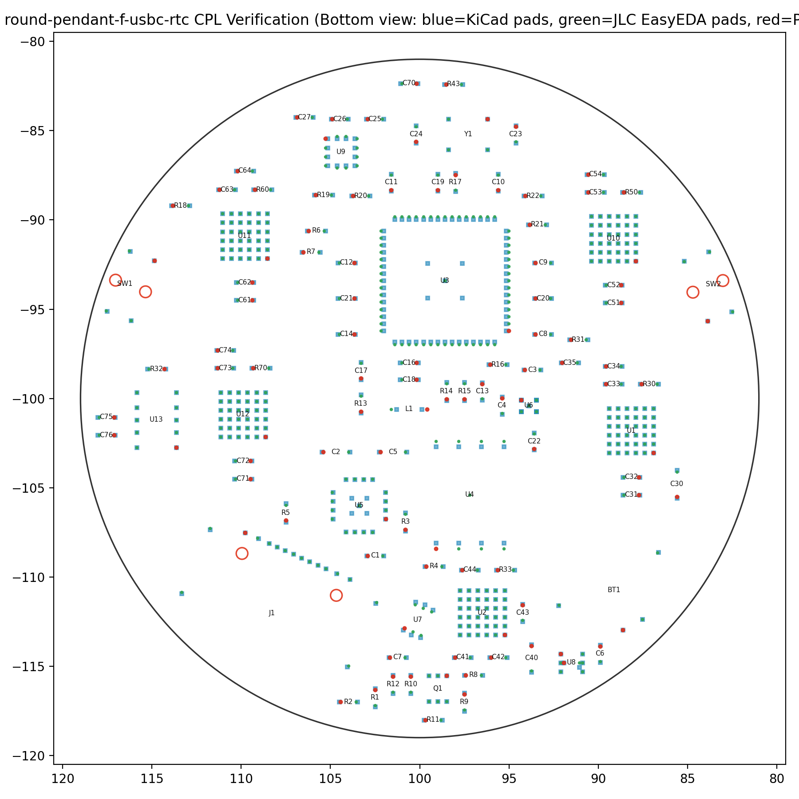
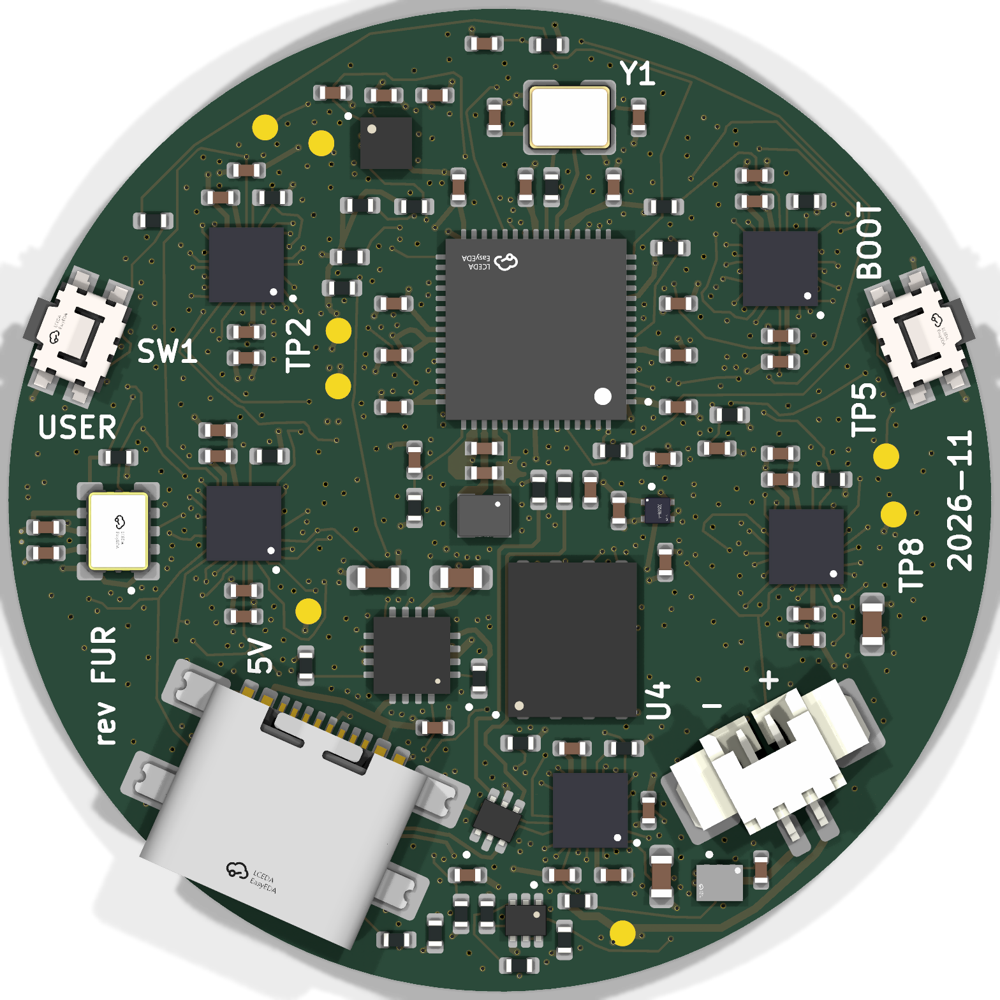

**Gate 10 — final release (`round-pendant-f-usbc-rtc`, `Rev FUR`).** Complete fab package in `hw/round-pendant/f-usbc-rtc/fab/` (`JLC08101H-1080` 8-layer `1.0 mm` ENIG + POFV): `0` ERC errors, `0` DRC errors/warnings, `0` unconnected, `0` copper/pad-joint/silk errors, intact `GND`/`VSYS`/`+3V3`/`+1V1` planes (`dPcs = +0` vs `f-usbc`), `236/236` front parts & `147/147` locked `RP2350` decoupling tracks untouched.

**Key release checks verified:**

- **CPL rotations & EasyEDA `c_origin` verified across all `338` assembled parts (`35` unique LCSC codes):**
  - **`BT1` (`CJT A1251WR-S-2P`, `C225111`):** `Mid = (89.1061mm, -110.7266mm)`, `Bottom`, `Rotation = 208.00°` (`+0.200 mm` `c_origin` shift, `0.050 mm` pad-for-pad match across all `4` pads, mouth facing inward NNE toward `U4` — keep `208.00°` in JLC DFM review; order with **`POFV = Yes`** and **`DO NOT ULTRASONIC CLEAN`** for `U13`'s `32.768 kHz` crystal).
  - **`U13` (`Seiko Epson RX8130CE:BB`, `C1542426`):** `Mid = (114.7500mm, -101.2000mm)`, `Bottom`, `Rotation = 180.00°` (`0.000 mm` pad-for-pad match across all `10` pads).
  - **`J1` (`Hroparts TYPE-C-31-M-22`, `C530612`):** `Mid = (108.2778mm, -112.0309mm)`, `Bottom`, `Rotation = 336.05°` (`0.077 mm` pad match across all `16` pads).
- **Split drill files & NPTH review (`5,883` tracks, `918` vias):** `round-pendant-PTH.drl` (`918` epoxy-filled POFV vias) and `round-pendant-NPTH.drl` (`6` unplated peg holes: `2× Ø0.65 mm` `J1` + `4× Ø0.70 mm` `SW1/SW2`), verified in `gerbonara` with `≥ 0.201 mm` copper clearance across all 8 layers and `0` intrusions inside `RX8130_xtal_end`.
- **Live JLCPCB PCBA stock (`2026-11-09`):** **`33/35` BOM lines are in immediate local JLCPCB SMT stock** — including **`C1542426 RX8130CE:BB = 2,242`**, **`C225111 A1251WR-S-2P = 74,983`**, **`C530612 TYPE-C-31-M-22 = 2,400`**, **`C42411119 L1 = 1,299`**, and all `3` new RTC passives as Basic Parts (`C1525`, `C52923`, `C25741` — `0` extra feeder fees!). Only Variant F's two inherited Global-Sourcing parts (`C2678907 IS31FL3745` WLCSP-36 driver and `C146233 ALS-PT19` sensor, or local JLC drop-in `C47416518`) need Global Sourcing / pre-order.
