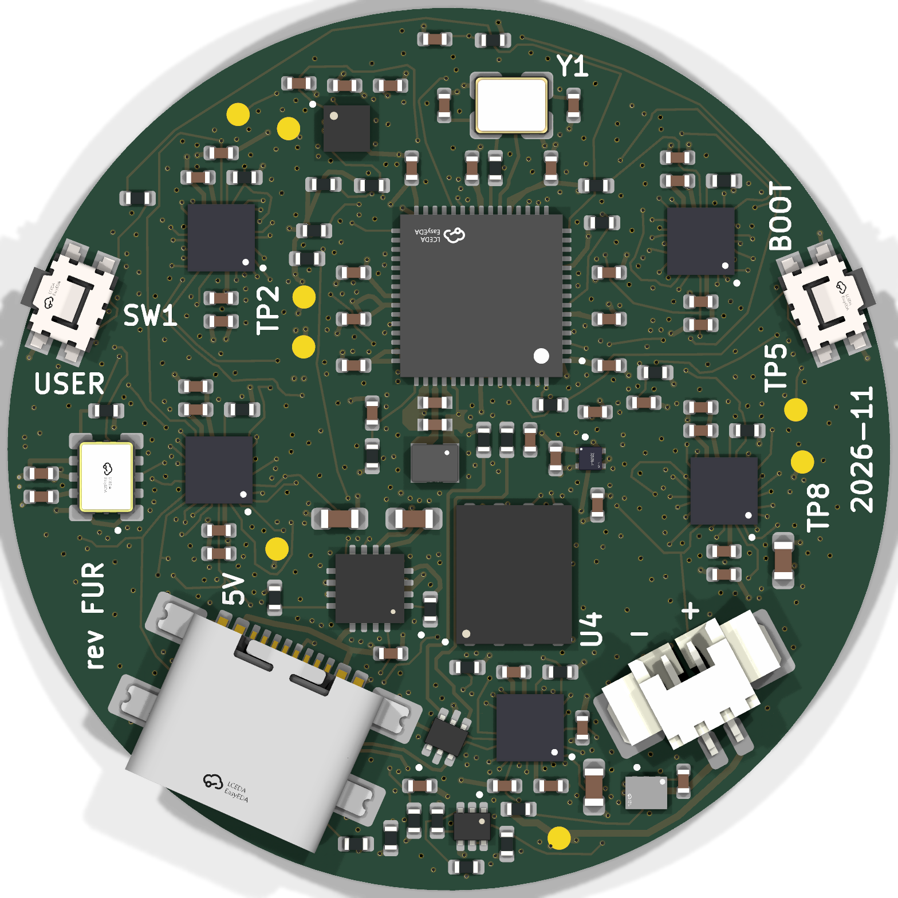
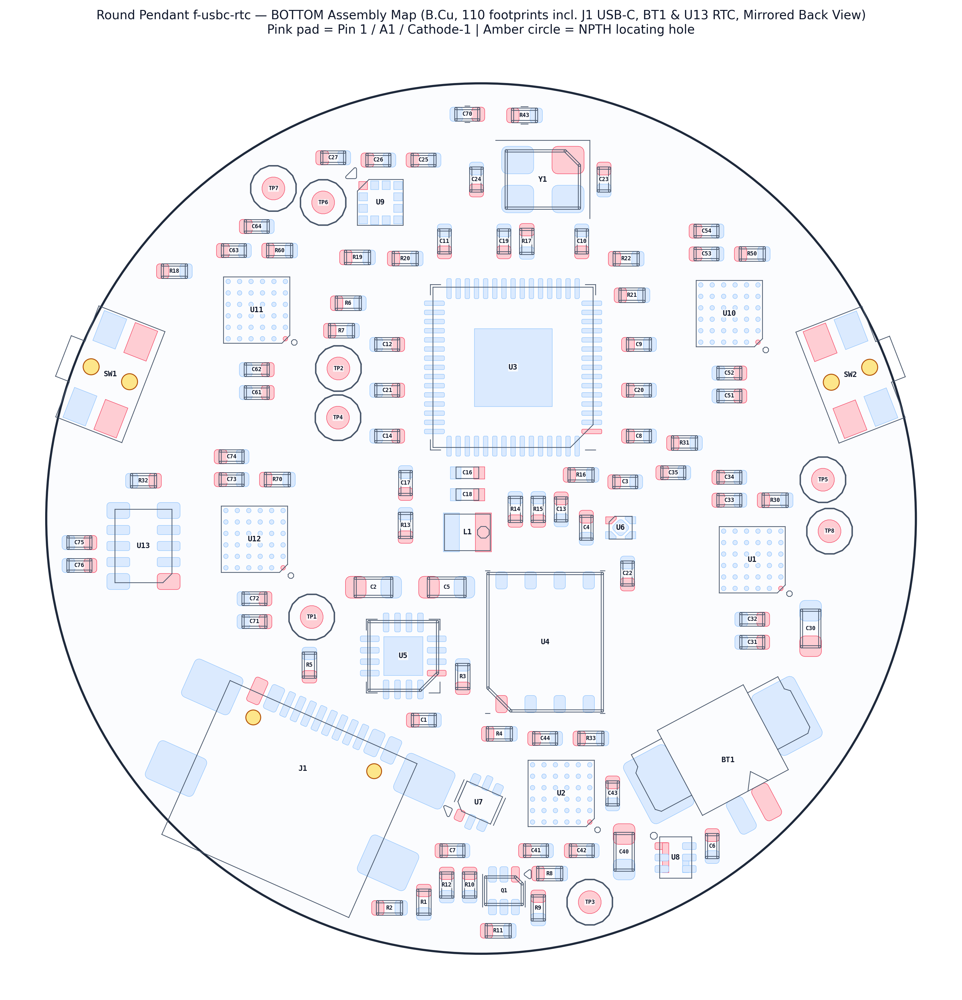

**Gate 4 — mechanical and layout brief (`round-pendant-f-usbc-rtc`, `Rev FUR`).** Extends `round-pendant-f-usbc` (`TYPE-C-31-M-22` full-SMT USB-C) on the 8-layer, 235-LED `Ø38.0 mm` Round Pendant by adding an **inward-facing `1.25 mm` PicoBlade / MX1.25 right-angle SMT battery socket (`BT1`: `CJT A1251WR-S-2P`, `C225111`)** and a **Seiko Epson `RX8130CE:BB` (`C1542426`) Real-Time Clock (`U13`)** with **zero front LEDs moved (`236/236` exact)** and **zero added stack thickness**.

**What changed from `round-pendant-f-usbc`:**

- **Inward-facing `BT1` (`CJT A1251WR-S-2P`, `C225111`, `$0.09/bd` @ qty 10):** Placed on `B.Cu` in the SW sector at `(89.200, 110.550) mm`, `rot = -28.00°`, facing **inward NNE (`+28°` East of North)** into a **`4.88 mm` nominal (`4.65 mm` min to `U4`, `5.85 mm` to `C22`) flat plug-insertion runway** between `U1`/`C31` and `U4`/`U2` (`cjt-a1251.pdf` `A1251H-2P` `4.00 ± 0.25 mm` plug length / `5.80 mm` mated wafer + plug; mate `BT1` after DMM polarity check before adhering the rear `35 mm` LiPo). Its `3.20 mm` thermoplastic body matches `J1`'s `3.16–3.26 mm` USB-C shell (`0 mm` added stack thickness, `0` rim overhang, `0` bezel cutouts).
- **East `U13` (`Seiko Epson RX8130CE:BB`, `C1542426`, `$0.72/bd` @ qty 10; total BOM `$27.44/bd`, `+$0.82` vs `f-usbc`):** Placed in the vacant East `B.Cu` pocket at `(114.750, 101.200) mm` (`0` existing parts moved there) with `C75` (`100 nF`, `1.23 mm` from `VDD`), `C76` (`1 µF`, `1.23 mm` from `VOUT`), `R32` (`100 kΩ` wake pull-up), and locked `B.Cu` keepout `RX8130_xtal_end` under its crystal inspection edge (`ETM50E-10` Fig. 9). Runs on `I2C1` (`400 kHz`, `0x32`), tied to always-on `+3V3` (`1.50 µA` active with `FOUT = OFF`), and wakes `RP2350A` from deep sleep via `POWMAN` `PWRUP2` on `U3` Pin `31` (`GPIO19`).
- **All `235` front LEDs, `Q2`, `J1` USB-C, `SW1/SW2`, `U1..U7`, `U9..U12`, and all `147` locked `RP2350` decoupling links remain `100%` untouched.**
