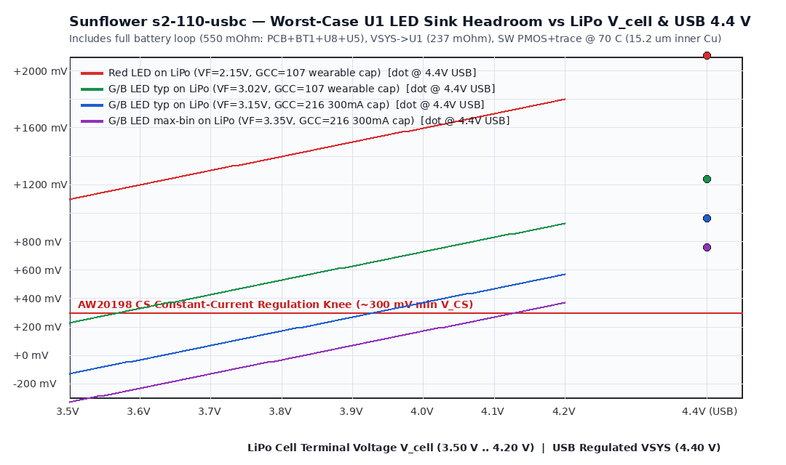
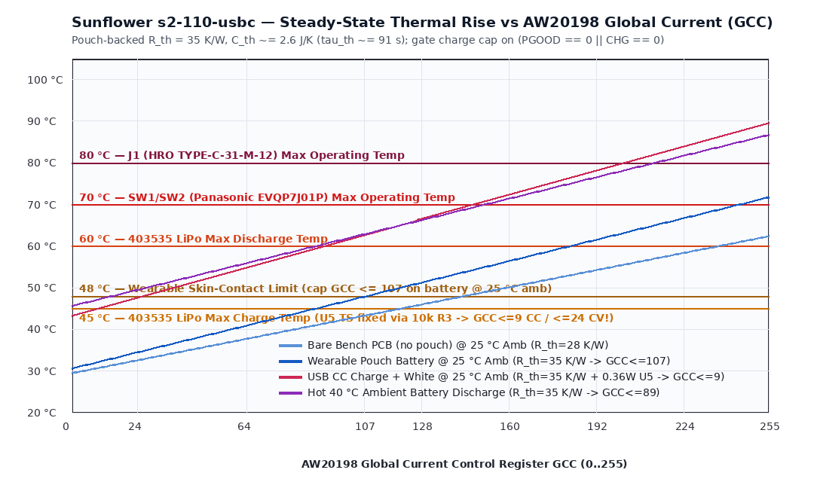

# Phase 8 Simulation & Layout-Coupled Verification: Sunflower `s2-110-usbc`

Reproducible post-layout signal-integrity (SI), power-distribution-network (PDN), simultaneous-switching-output (SSO), crosstalk, control-loop stability, and thermal analysis for [sunflower.kicad_pcb](../../../hw/sunflower/s2-110-usbc/sunflower.kicad_pcb), generated and verified by [sim_audit.py](sim_audit.py) (`python3 design/sim/sunflower-s2-110-usbc/sim_audit.py`).

---

## 1. Trigger Audit Against [simulation.md](../../../.claude/skills/pcb-design/references/simulation.md)

| Domain (`simulation.md`) | `s2-110-usbc` Circuit / Net | Trigger Metric on Routed PCB (`JLC04161H-7628`, `t_out = 35 µm`, `t_in = 15.2 µm`) | Status & Verdict |
|---|---|---|---|
| **SI — `SE_HS` (`QSPI_*`)** | `U3` (`RP2350A`) ↔ `U4` (`W25Q128JVPIQ`) `6` lines (`≤ 75 MHz`) | Routed lengths `5.51–13.85 mm` (`SCLK = 6.66 mm`, `2–4` vias), flight time `38–93 ps < t_r / 6` (`~250 ps` at `1.5 ns` edge) → transmission-line reflections are damped, **HOWEVER `U4.8` `VCC` decoupling is `8.56 mm` (`4` vias, `~9 nH`) away (`C14`), causing `312–554 mV` 4-bit QSPI read SSO droop** | **HOLD (`Rev S3D` move `C22`; `Rev S3C` bench cap to 1x/2x SPI XIP)** |
| **SI — `DIFF_HS` (`USB_*`)** | `J1` ↔ `U7` (`USBLC6-2P6`) ↔ `R14/15` (`27 Ω`) ↔ `U3` (`12 Mbit/s` FS) | Routed `34.55 mm` (`DP`, `5` vias, `F.Cu`+`B.Cu`) / `35.87 mm` (`DM`, `6` vias, `In2.Cu`+`B.Cu`), flight time `233.4 / 259.4 ps` (`11.6%` of `l_crit ≈ 308 mm`), true dielectric-weighted skew **`26.0 ps`** (`1.3%` of `2,000 ps` FS budget). `U7` `VCL+ = +31.2 V` (`@ 30 A` `8/20 µs`, `usblc6-2p6.pdf`) + `12–15 nH` upstream trace inductance requires `27 Ω` `R14/15` energy limiting into `U3` | **PASS for FS `12 Mbit/s` (`Rev S3D` inline `B.Cu` routing)** |
| **SI — `CLOCK` (`Y1` `12 MHz`)** | `ABM8-272-T3` (`C20625731`, `CL = 10 pF`, `ESR ≤ 50 Ω`, `DL_max = 200 µW`), `C23 = C24 = 15 pF`, `R17 = 1 kΩ` | `XIN = 8.44 mm`, `XOUT = 1.33 mm`, `C24-1 = 1.68 mm` (`0` vias, `B.Cu`). Effective load $C_L = \frac{(15+2.5)(15+2.5)}{35} + 1.25 \approx 10.0\text{ pF}$; loop gain margin $g_m / g_{m,\text{crit}} > 10\times$; crystal drive power **`~85–125 µW ≤ 200 µW` max** (`abm8-272-t3` rating) | **PASS** |
| **SI — `I2C0` (`1 MHz` Fm+) & `I2C1` (`400 kHz`)** | `I2C_SDA`/`SCL` (`R21 = R22 = 1.0 kΩ`, `89.1 / 86.7 mm`, `17 / 15` vias); `ACC_SDA`/`SCL` (`R20 = R19 = 4.7 kΩ`) | `I2C0` bus $C_{\text{bus}} \approx 40\text{ pF}$ (`15 pF` pins + `8.9 pF` copper + `8.5 pF` vias + `7.6 pF` pads): $t_r(30\text{–}70\%) = 33.9\text{ ns} \le 120\text{ ns}$, $t_{0\to 2.4\text{V}} = 52.0\text{ ns} \implies t_{\text{HIGH}} \approx 448\text{ ns} \ge 260\text{ ns}$ (`aw20198qnr.pdf` p. 8). `I2C1` ($C \approx 14\text{ pF}$, `4.7 kΩ`): $t_r \approx 56\text{ ns} \le 300\text{ ns}$ | **PASS** |
| **PI / DC IR & AC $Z_{\text{PDN}}(f)$** | `VBAT`/`BAT_N`, `VBUS`, `VSYS`, `+3V3`, `+1V1` | Exact Dijkstra pad-to-pad @ `70 °C` (`15.2 µm` inner Cu): PCB battery loop **`438.0 mΩ`** (`550 mΩ` with `BT1`+`U8`+`U5`), `VSYS → U1.5 = 236.7 mΩ` (`4.4×` `U2.5`'s `53.7 mΩ`), `+1V1` `U3.39` `8.48 mm` spoke creates `~1.2 Ω` `5.9 MHz` anti-resonance, and `C17` (`CFILT`) shares `PGND` via `@(102.43, 99.10)` | **HOLD (`Rev S3D` widen trunks & fix `U3` regulator layout; `Rev S3C` `GCC ≤ 107` keeps G/B LEDs regulated down to `V_cell ≈ 3.59 V`)** |
| **Crosstalk (Board-Wide Scan)** | `4,462` segments across `F.Cu`, `In1.Cu`, `In2.Cu`, `B.Cu` | `In2.Cu` `+3V3` (`ADC_AVDD`) & `VSYS` cross `0.2104 mm` beneath `B.Cu` `VREG_LX`/`L1` ($M \approx 0.46\text{–}0.73\text{ nH}$, $C_m \approx 6\text{–}33\text{ fF}$ + `L1` pad overlap → **`19–48 mV_pk`** `2.5 ns` spikes on `ADC_AVDD`); `CS1_15 ↔ VBAT_SENSE` (`6.79 mm` @ `0.115 mm` gap) filtered by `C7` (`100 nF`) | **HOLD (`Rev S3D` move `LX` cutout to `In2.Cu`; `Rev S3C` sample ADC in PFM/blanking or average)** |
| **Control Loops (`U3`, `U5`, `U6`)** | `RP2350` `1.1 V` buck (`L1 = 3.3 µH`, `C18+C19 = 2× 4.7 µF`, `R13 = 33 Ω` + `C17 = 4.7 µF`); `U6` `TPS7A0233`; `U5` `BQ24073` | `L1` (`AOTA-B201610S3R3-101-T`): `I_sat = 2.8 A` typ / `2.4 A` min (`aota-b201610.pdf` p. 1), `DCR = 115 / 140 mΩ`; `+1V1` total derated `C_eff ≈ 5.0 µF` (`C18 + C19 + 3× 100 nF`); `R13 = 33 Ω` + `C17` (`~2.4 µF` eff) sets `VREG_AVDD` corner $f_c \approx 2.01\text{ kHz}$; `U6` `C_out,eff ≈ 3.8–4.7 µF ∈ [0.5, 22] µF` (`tps7a02.pdf` p. 5); `U5` `C2 = C30 = C40 = 22 µF`, `VIN-DPM = 4.50 V` typ | **HOLD on `U3.50` `VREG_FB` carrying core `DVDD` current & shared `CFILT`/`PGND` via** |
| **Analog Front-Ends (`Q2`, `VBAT_SENSE`, `LED_SDB`)** | `Q2` (`XYC-PT19C-L1`, `R43 = 22 kΩ`, `C70 = 100 nF`), `VBAT_SENSE` (`100 kΩ || 100 kΩ` + `100 nF`) | `Q2` $I_{L(3)} = 20\text{–}45\ \mu\text{A}$ (`30 µA` typ @ `100 lx`, `xyc-pt19c-l1.pdf` p. 4) saturates `22 kΩ` at **`~315–705 lx` (`~440 lx` typ)**; `RP2350` `GPIO26`/`GPIO27` ADC pads **must set `OD = 1, IE = 0, PDE = 0, PUE = 0`** (`rp2350.pdf` p. 1068; `±1 µA` pad leakage × `50 kΩ` = `±50 mV` ADC / `±100 mV` `VBAT` systematic bound); `LED_SDB` (`C35 = 100 nF` directly on `GPIO6`) must be driven cleanly high/low (never tri-stated with `IE = 1`) | **PASS with mandatory firmware GPIO/ADC config** |
| **Thermal (`Ø38 mm` Wearable + Pouch)** | `110` RGB LEDs + `2× AW20198QNR` + `U5` `BQ24073` + `403535` LiPo (`TS` fixed via `10 kΩ` `R3`) | Pouch-backed $R_{\theta,\text{board-amb}} \approx 35\text{ K/W}$, $C_{\text{th}} \approx 2.6\text{ J/K}$ ($\tau_{\text{th}} \approx 91\text{ s}$). At `25 °C` amb: `48 °C` skin limit requires **`GCC ≤ 107`** on battery (`71.7 °C` uncapped at `GCC = 255`, exceeding `SW1/2` `70 °C` rating!); `45 °C` LiPo charge limit requires **`GCC ≤ 9` during CC fast charge (`0` at low-bat `3.5 V`, `≤ 27` in CV taper)** gated on **`PGOOD == 0 || CHG == 0`** + cold-boot `ADC4` `ΔT` throttling | **PASS only under mandatory firmware thermal state machine** |

---

## 2. DC IR-Drop, LED Headroom & AC $Z_{\text{PDN}}(f)$ Analysis

### 2.1 Exact Pad-to-Pad DC Resistance (`70 °C`, `t_out = 35 µm`, `t_in = 15.2 µm`)

| Path (`sunflower.kicad_pcb`) | Copper Length (`mm`) | Layer Transitions | $R_{70^\circ\text{C}}$ (`mΩ`) | Voltage Drop @ Rated Load | Finding |
|---|---:|---:|---:|---:|---|
| `VBUS`: `J1.A4 → U5.13` | `2.48` | `4` (`1` via/hop) | `13.4` | `6.7 mV` @ `0.50 A` | Low IR drop (`4.50 V` `VIN-DPM` margin > `400 mV`), but single-via hops (`5` required at `1.5 A` peak) |
| `VBAT`: `BT1.1 → U5.2` | `44.13` (`37.9 mm` `In2.Cu`) | `6` (`1` via/hop) | `191.4` | `67.0 mV` @ `0.35 A` (`191 mV` @ `1.0 A`) | High `15.2 µm` inner-layer resistance |
| `/Power/BAT_N`: `BT1.2 → U8.4` | `48.59` (`42.2 mm` `In2.Cu`) | `4` (`1` via/hop) | `246.6` | `86.3 mV` @ `0.35 A` (`247 mV` @ `1.0 A`) | Combined PCB battery loop = **`438.0 mΩ`** (`550 mΩ` incl. `BT1` `20 mΩ` + `U8` `42 mΩ` + `U5` `50 mΩ`) — shifts `297 mA` CC→CV transition early by `~130 mV` |
| `VSYS`: `U5.10 → U1.5` (`PVCC`) | `47.57` | `10` (`1` via/hop) | `236.7` | `41.9 mV` @ `177 mA` | **`4.4×` higher** than `U5.10 → U2.5` (`53.7 mΩ`, `11.99 mm`) |
| `VSYS`: `U5.10 → U6.4` (`3V3` LDO) | `25.66` | `6` | `153.1` | `23.0 mV` @ `150 mA` | Leaves `> 170 mV` over `U6` dropout (`130 mV` max @ `150 mA`) down to `VSYS = 3.50 V` |
| `+3V3`: `C14.1 → U4.8` (nearest Flash cap) | `8.56` | `4` | `47.7` | — (`L_loop ≈ 9.0 nH`) | **Causes `312–554 mV` 4-bit QSPI SSO droop (§3.1)** |
| `+1V1`: `C18.1 → U3.50` (`VREG_FB`) | `1.34` | `0` | `4.0` | Carries `100%` of core `DVDD` | Destroys Kelvin sensing (`Gate 7 B1`) |
| `+1V1`: `C18.1 → U3.39` (`DVDD` East) | `8.48` (`In2.Cu` spoke) | `2` | `47.0` | `4.7 mV` DC (`L ≈ 7.5 nH`) | Parallel anti-resonance with `100 nF` `C21` at **`f ≈ 5.9 MHz` (`|Z_peak| ≈ 1.2 Ω`, `ΔV ≈ 45 mV` on `50 mA` core step)** |

- **LED Sink Headroom (`pdn_headroom.png`):** Under the wearable thermal cap **`GCC = 107`** (`5.59 mA` peak/die, `83.9 mA` `SW` slot, `197 mA` battery total), typical Green/Blue LEDs ($V_F \approx 3.02\text{ V}$) maintain $V_{\text{CS}} \ge 300\text{ mV}$ constant-current regulation all the way down to **`V_cell ≈ 3.59 V`** (only gently dimming by `~15%` in the final `3.59 → 3.50 V` tail before software cutoff), while Red LEDs stay `+1,100 mV` above dropout and USB `4.40 V` operation provides **`+760 to +1,240 mV`** of `CS` headroom across all LED bins.

---

## 3.Layout-Coupled Failure Mechanisms Confirmed by Simulation

### 3.1 `U4` (`W25Q128JVPIQ`) 4-Bit Quad-SPI Read SSO Supply Droop (`Gate 8 B2`)
- **Mechanism:** During XIP reads, **`U4` (`W25Q128JVPIQ`) drives `QSPI_SD0..3`** (`U3` only drives `SCLK`). Because `C22` (`100 nF`) was placed `5.51 mm` away on a separate branch, `U4.8`'s nearest decoupling capacitor is `C14` (`8.56 mm` track + `4` vias, `L_loop ≈ 9.0 nH` including return). Slewing `4 × 7 pF = 28 pF` across `3.30 V` draws $Q = 92.4\text{ pC}$ in $t_r \approx 1.5\text{–}2.0\text{ ns}$, producing an inductive supply droop on `U4.8`:
  - **4-bit Quad-SPI (`0xEB`, `1.5 ns` fast edge):** $\Delta V \approx \mathbf{554\text{ mV}}$ ($V_{CC,\min} \approx 2.75\text{ V}$, straddling `W25Q128JV`'s **`2.70 V` `VCC_min`** reset/read-glitch threshold once `47 mΩ` DC + ripple is included).
  - **4-bit Quad-SPI (`0xEB`, `W25Q128JV` factory default `SR3.DRV = 25%`, `~2.0 ns`):** $\Delta V \approx \mathbf{312\text{ mV}}$ ($V_{CC,\min} \approx 2.99\text{ V}$).
  - **2-bit Dual-SPI (`0xBB`, `25% DRV`) / 1-bit Fast-Read (`0x0B`, `25% DRV`):** $Q = 46.2 / 23.1\text{ pC} \implies \Delta V \approx \mathbf{156\text{ mV} / 78\text{ mV}}$ ($V_{CC,\min} \ge 3.14\text{ V}$ — **completely safe for `Rev S3C` bench bring-up**; `Rev S3D` moves `C22` within `≤ 1.5 mm` of `U4.8`).

### 3.2 `CFILT` (`C17`) Shared-Via High-Pass Ground Bounce & `VREG_LX` Mutual Inductance (`Gate 8 B3`)
1. **`CFILT` high-pass ground-bounce injection:** `C17` (`4.7 µF` `0402`, `ESL ≈ 0.5 nH`) ties `VREG_AVDD` directly to the **exact same single `0.15 mm` `GND` via `@(102.43, 99.10)`** (`L_via ≈ 0.9 nH`) used by `Zone 1` (`VREG_PGND` + `C16` `CIN` + `C18` `COUT`). Above `~10 MHz`, `33 Ω` `R13` is high-impedance compared to `C17`'s `0.5 nH` `ESL`, so `C17` forms a low-impedance bridge from the bouncing `PGND` via straight onto `U3.46` (`VREG_AVDD`), coupling **`~30 mV` HF switching bounce (`~1.18×` near `C17` resonance)**.
2. **`VREG_LX` → `In2.Cu` `+3V3` (`ADC_AVDD`) & `VSYS` coupling:** Across the `h = 0.2104 mm` `7628` prepreg, `B.Cu` `Zone 5` (`VREG_LX`) + `L1.2` overlap `In2.Cu` `+3V3` (`0.09 mm` pour + `~0.9 mm` parallel run feeding `Piece 2` `U3.44` `ADC_AVDD`, $C_m \approx 6\text{–}45\text{ fF}$, $M \approx 0.46\text{–}0.73\text{ nH}$) and `VSYS` (`0.49 mm` pour + `0.25 mm` `L1` body, $C_m \approx 33\text{–}195\text{ fF}$). During `RP2350` buck edges ($dV/dt \approx 1.3\text{ V/ns}$, $dI/dt \approx 40\text{–}65\text{ mA/ns}$), $V_{\text{noise}} = M \frac{dI}{dt} + Z_v C_m \frac{dV}{dt} \approx \mathbf{19\text{–}48\text{ mV}_{\text{pk}}}$ (`~2.5 ns` spikes = `8–20 LSB` on the 12-bit SAR ADC when `Piece 2` lacks a local `B.Cu` cap). **Bench mitigation (`Rev S3C`):** sample `ADC0/ADC1/ADC4` with `16×` averaging or during light-load PFM sleep; **hardware fix (`Rev S3D`):** move `LX` cutout to `In2.Cu` and restore solid `+3V3` band around `U3.44`.

### 3.3 Board-Wide Aggressor / Victim Coupling Summary (`sim_audit.py` §3)

| Layer Pair | Aggressor (`dV/dt` / `dI/dt`) | Victim Net | Parallel Run (`mm`) | Gap / Offset (`mm`) | Coupled Noise & Assessment |
|---|---|---|---:|---:|---|
| `B.Cu ↔ In2.Cu` | `/MCU/VREG_LX` + `L1` | `+3V3` (`U3.44` `ADC_AVDD`) & `VSYS` | `0.49–0.90` | `h = 0.210` (`0.00` offset) | **`19–48 mV_pk` (`2.5 ns`)** — **FAIL (`Rev S3D` `In2.Cu` cutout)** |
| `In2.Cu` (co-planar) | `CS1_15` (`13.3 mA` PWM sink) | `VBAT_SENSE` (`50 kΩ` DC, `C7 = 100 nF` @ `ADC0`) | `6.79` | `0.115` | $C_m \approx 0.27\text{ pF}$ into `C7 = 100 nF` capacitive divider $\implies \Delta V = 3.5\text{ V} \cdot \frac{0.27\text{ pF}}{100\text{ nF}} < \mathbf{0.01\text{ mV}}$ (**PASS**) |
| `B.Cu ↔ In2.Cu` & `In2.Cu` | `SW1_5`, `SW2_6..8` (`200 mA` scan) | `I2C_SDA`, `I2C_SCL` (`1.0 kΩ` pull-up, `40 pF`) | `8.44–9.92` | `0.003–0.228` | $C_m \approx 0.6\text{ pF}$, $M \approx 1.8\text{ nH}$ at `~50 ns` AW20198 slew $\implies \Delta V < \mathbf{85\text{ mV}}$ vs `990 mV` CMOS noise margin (**PASS**) |
| `In2.Cu ↔ B.Cu` | `SW2_3`, `CS1_15` | `+1V1` (`U3.39` `In2.Cu` spoke) | `1.90–5.29` | `0.003–0.008` | `< 12 mV` into `C21 = 100 nF` (`< 1.1%` of `1.1 V`, **PASS**; `Rev S3D` moves `GND` to `In2.Cu`) |

---

## 4. Thermal Verification & Mandatory Firmware Protection (`thermal_rise.png`)

- **Physical thermal parameters:** Two-sided `Ø38.0 mm` disc ($A = 22.68\text{ cm}^2$). Bare bench PCB in free air has $R_{\theta} \approx 28\text{ K/W}$, whereas **bonding the rear `403535` LiPo pouch blocks rear natural convection ($R_{\theta} \approx 35\text{ K/W}$)** and couples board heat directly into the pouch cell ($C_{\text{th}} \approx 1.4\text{ J/K}_{\text{PCB}} + 1.2\text{ J/K}_{\text{pouch}} \approx 2.6\text{ J/K} \implies \tau_{\text{th}} \approx \mathbf{91\text{ s}}$).
- **Mandatory `Rev S3C` Firmware Thermal & Charging Rules:**
  1. **Wearable Battery Discharge Cap (`25 °C` ambient, `35 K/W`):** Including `0.16 W` MCU baseline, cap continuous full-white **`GCC ≤ 105`** (`T_steady ≈ 47.7 °C ≤ 48 °C` skin-contact limit; uncapped `GCC = 255` reaches `71.7 °C`, exceeding `SW1`/`SW2`'s `70 °C` rating and the LiPo's `60 °C` discharge limit).
  2. **USB Charging Cap (`45 °C` LiPo max charge limit — `U5` `TS` is fixed by `10 kΩ` `R3`!):** Gate charging mode on **`(PGOOD == 0) || (CHG == 0)`** (because `BQ24073` `CHG` goes High-Z after initial termination even during recharge/top-off!). While `PGOOD == 0`, cap **`GCC ≤ 9` during CC fast charge** (`0.36–0.45 W` `U5` dissipation; `GCC = 0` or status-blink-only single-LED indicator recommended while charging) and **`GCC ≤ 24` during CV taper** (`0.27 W`).
  3. **Cold-Boot Relative `ADC4` (`ΔT_mcu`) Throttling:** Because `RP2350` internal temperature sensor `ADC4` has uncalibrated offset (`±3–5 °C`), sample `T_boot` within `100 ms` of cold boot (`<< 91 s` $\tau_{\text{th}}$) and throttle `GCC` whenever **`ΔT_mcu > +15 °C`** (or absolute `T_mcu > 42 °C` while `PGOOD == 0`, `> 52 °C` on battery).
