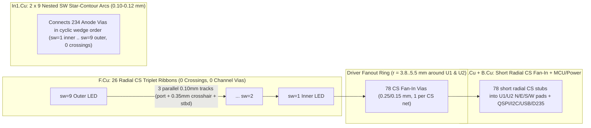

# Independent Routing Attack Plan: `round-pendant` (235-LED 38 mm 6-Layer Board)

> [!IMPORTANT]
> **Bottom-Line Feasibility Verdict: YES — 100% physically feasible on the existing 6-layer JLC 1.0 mm through-via stackup (`F.Cu, In1.Cu, In2.Cu=GND, In3.Cu, In4.Cu=VSYS/+3V3, B.Cu`), keeping all 235 LEDs, `D235` at `(0.05, -0.65)`, both planes intact, and JLC standard rules (`0.10/0.09 mm` tracks, `0.25/0.15 mm` vias).**
>
> Across the tightest global chord (`x = +3.0 mm`), the board has **562 legal `0.10/0.09 mm` track slots** vs. **75 MST net crossings** (**7.5× capacity**); around each QFN-60 LED driver (`U1`, `U2`), `B.Cu + In1.Cu + In3.Cu` provide **545 track slots** and **>100 legal via sites** for **52 escaping nets** (**10.5× track / 2.1× via capacity**).
>
> Trials 5–7 stalled at **118 signal open, 67 plane open, and 50 DRC errors** ([`autoroute.json`](../../../../hw/round-pendant/b-fan/route/autoroute.json#L1-L16)) not because the stackup is out of room, but because of **four deterministic geometry/rule bugs** combined with **3D topological tangling** (262 channel-corking CS vias on `F.Cu` and `1,092 mm` of `0.20 mm`-wide SW tracks shredding `In1.Cu` and `In3.Cu`).

---

## 1. Four Deterministic Bugs Hiding in the Current Baseline

Before touching router heuristics or moving parts, four concrete defects in [`scripts/board.py`](../../../../scripts/board.py) and [`design/nets.csv`](../../../nets.csv) account for virtually all 50 DRC errors, ~23 of the plane/power opens around `U3`, and half the inner-layer congestion:

1. **All 18 `SW` matrix scan nets are routed as `0.20 mm` tracks with `0.30 mm` vias (`POWER` class) instead of `0.10 mm` / `0.25 mm`:**
   - [`design/nets.csv`](../../../nets.csv#L43-L51) (and lines 91–99) assigns `SW1_1..9` and `SW2_1..9` to `POWER` (`0.20 mm` track, `0.30/0.15 mm` via in [`board.py:21`](../../../../scripts/board.py#L21)).
   - [`board.py:59-60`](../../../../scripts/board.py#L59-L60) intended `0.10 mm` (`# 0.1 mm on 0.5 oz inner carries the average with room`) and wrote `(constraint track_width (min 0.1mm))` into `.kicad_dru`. Two things went wrong: (a) [`ultraroute`'s DRU parser](../../../../vendor/ultraroute/core/crates/kicad-pcb/src/dru.rs) rejects `=~` (`warning: .kicad_dru:51: condition could not be read`, [`s0.log:1`](../../../../hw/round-pendant/b-fan/route/s0.log#L1)); and (b) `min 0.1mm` never overrides a *wider* netclass width (`0.20 mm` in [`Profile::for_net`](../../../../vendor/ultraroute/core/crates/grid/src/grid.rs#L72-L85)).
   - **Empirical impact in `b-fan`**: `ultraroute` laid **1,092.0 mm** of `0.20 mm`-wide `SW` copper (`488.6 mm` on `In1.Cu`, `493.6 mm` on `In3.Cu`, `104.2 mm` on `B.Cu`, `55.6 mm` on `F.Cu`) plus `35` `0.30 mm` vias — inflating track pitch by **+52.6%** (`0.29 mm` vs `0.19 mm`) and **halving** inner-layer track count between anode vias (from 4 tracks to 2 tracks per `1.30 mm` via span).
   - **Electrical check (`0.5 oz = 15.2 µm` inner Cu, $R_\square = 1.13\text{ m}\Omega/\square$)**: Peak row current is $9 \times 3 \times 18.3\text{ mA} = 494\text{ mA}$ at $1/10.125$ duty ($32\ \mu\text{s} / 324\ \mu\text{s}$), so $I_{\text{avg}} = 48.8\text{ mA}$ and **$I_{\text{rms}} = 494 / \sqrt{10.125} = 155.3\text{ mA}$** (note: Joule heating scales with $I_{\text{rms}}^2$, not $I_{\text{avg}}^2$, giving $4.1\text{ mW}$ on a `15 mm × 0.10 mm` inner trace — `< 0.5 °C` rise). Worst-case all-white peak IR drop on a `6 mm × 0.12 mm` driver feed + `20 mm × 0.10 mm` distributed arc ($0.5 \times 494\text{ mA}$ mean load along the arc) is $28 + 56 = \mathbf{84\text{ mV}}$, well inside the `160 mV` budget in [`intent.md`](../../../intent.md) (`3.50 V` min VSYS − `3.20 V` max G/B $V_F$ − `0.14 V` driver headroom). Moving `SW` to a dedicated `SW_SCAN` class (`0.10` or `0.12 mm` track, `0.09 mm` clearance, `0.25/0.15 mm` via) immediately reclaims ~40% of `In1.Cu`/`In3.Cu`.

2. **`U3` (`RP2350` at `(-1.40, -6.60)`) has an undersized `+3V3` band (`sq(2.8)`) AND a plain track keepout (`sq(2.9)`) that walls off its own power pins:**
   - In [`RP2350-QFN-60-1EP...kicad_mod`](../../../../.claude/skills/pcb-design/footprints/RP2350-QFN-60-1EP_7x7_P0.4mm_EP3.4x3.4mm_ThermalVias.kicad_mod#L55), pads sit at `±3.4375 mm` with length `0.875 mm`, so their **inner copper edges sit at $3.4375 - 0.4375 = \mathbf{3.000\text{ mm}}$** from `U3` center.
   - [`zones_b()`](../../../../scripts/board.py#L562-L580) draws `"RP2350 band"` (`+3V3`) as `sq(2.8)` (`±2.800 mm`) — **falling `0.200 mm` short of every `U3` pad** — and then places a plain KiCad rule area `"U3 no tracks inside pads"` at `sq(2.9)` (`SetDoNotAllowTracks(True)`), directly violating [`LESSONS.md:23`](../../../../.claude/skills/pcb-design/LESSONS.md#L23) (*"Plain keepouts block every net... use a custom `.kicad_dru` `disallow track` rule with `A.NetName != ...`"*).
   - **Impact**: `"RP2350 band"` joins **zero** `U3` pins. All 10 `+3V3` pins (`1, 11, 20, 30, 38, 44, 45, 49, 53, 54`) are forced to escape *outward* into `U3`'s crowded `0.40 mm`-pitch GPIO/QSPI/USB ring (causing 20 `+3V3` plane opens and blocking `QSPI`/`XIN`/`I2C`), while `"RP2350 ring"` (`+1V1`, `sq(2.2)`) is walled off from `U3` pins `6, 23, 39, 50` (causing all 3 `+1V1` signal opens in [`autoroute.json:41-43`](../../../../hw/round-pendant/b-fan/route/autoroute.json#L41-L43)). Also, the `1V1`/`VREG_LX`/`PGND` regulator copper pours noted as *"First step of phase 7"* in [`phase6.md:16`](../../../gates/phase6.md#L16) were never added.

3. **All 50 `track_width` DRC errors come from `ultraroute`'s whole-connection [`forced_necks`](../../../../vendor/ultraroute/core/crates/grid/src/necks.rs) fallback on narrow power pads:**
   - `.kicad_dru` mandates `0.30 mm` min width on `VBAT`, `VSYS`, `/Power/BAT_N`, and `0.25 mm` on `VBUS` ([`board.py:55-58`](../../../../scripts/board.py#L55-L58)).
   - Yet `U5` (`TPS25947`, `0.50 mm` pitch QFN) has **`0.25 mm`-wide pads** (`U5-2,3` `VBUS`, `U5-8,9` `VSYS`), and `U8` (`BQ25185`, `0.50 mm` pitch) has **`0.28 mm`-wide pads** (`U8-2,3` `VSYS`, `U8-4,5` `VBAT`, `U8-8` `VBUS`). Because a `0.30 mm` capsule at the pad center breaches `0.09 mm` clearance to adjacent pads (`0.50 - 0.15 - 0.14 = 0.21 mm` is fine only when perfectly centered, and fails on `U5` where `0.50 - 0.15 - 0.125 - 0.09` clips on a `0.05 mm` grid), `forced_necks` ([`s0.log:39-65`](../../../../hw/round-pendant/b-fan/route/s0.log#L39-L65)) drops the **entire connection** (`7.26 mm` on `In3.Cu`!) to `0.20 mm` width, triggering 50 KiCad DRC violations.
   - **Fix**: Connect `VBAT`, `BAT_N`, `VBUS`, and `VSYS` in the south power bay (`y ∈ [+6, +17] mm`) with small `B.Cu` **copper zones** (as recommended in [`routing.md:7`](../../../../.claude/skills/pcb-design/references/routing.md#L7)), and add an explicit courtyard neck rule `(insideCourtyard('U5') || insideCourtyard('U8') || insideCourtyard('U7'))` (`min 0.20mm`) — calling this out explicitly per crunch rules because `0.25 mm` physical pads cannot legally accept `0.30 mm` tracks without necking inside the courtyard.

4. **67 `plane_open` items because [`autoroute.py`](../../../../.claude/skills/pcb-design/scripts/autoroute.py#L58-L60) does not pass `--plane-via-reach` and `preroute` only pre-stitched QFN EPs:**
   - `ultraroute` already supports `--plane-via-reach 0.6` ([`lib.rs:128-131`](../../../../vendor/ultraroute/core/crates/ultraroute/src/lib.rs#L128-L131)), which places rip-able plane vias within `0.6 mm` of every `GND`/`VSYS`/`+3V3` pad *before* signal routing and re-places them *after* routing, instead of hoping post-route `stitch_b()` finds room after signal tracks wall off decoupling caps.

---

## 2. First-Principles Capacity Arithmetic (Per Region & Layer)

All coordinates below are in **mm from board center `(0, 0)`** (`KiCad (100, 100)`, `+x` East, `+y` South/down), verified directly against `hw/round-pendant/c/route/preroute.kicad_pcb` and `hw/round-pendant/b-fan/round-pendant.kicad_pcb`.

### 2.1 The Hidden Hole-Clearance Theorem (`0.550 mm` Via Keep-Out, Not `0.430 mm`)

[`design/brief.md:72`](../../../brief.md#L72) assumes a `0.25/0.15 mm` via blocks `0.25 + 2×0.09 = 0.43 mm`. **It does not.** Both KiCad 9 DRC and `ultraroute` ([`board.py:35`](../../../../scripts/board.py#L35), [`check.rs:39,118,453`](../../../../vendor/ultraroute/core/crates/board/src/check.rs#L39)) enforce `min_hole_clearance = 0.200 mm` from the **plated drill edge** ($r_{\text{drill}} = 0.075\text{ mm}$) to **any foreign copper on every layer**:

$$R_{\text{keep}} = \max(r_{\text{via}} + c_{\text{cu}},\; r_{\text{drill}} + c_{\text{hole}}) = \max(0.125 + 0.090,\; 0.075 + 0.200) = \mathbf{0.275\text{ mm}} \quad (\mathbf{0.550\text{ mm}}\text{ diameter})$$

Empirically verified on `b-fan`: minimum foreign track-edge to via-center distance across all 775 vias is `0.2745 mm`. Likewise, minimum center-to-center pitch between two **foreign-net** `0.25/0.15 mm` vias is:

$$d_{\text{vv,min}} = r_{\text{drill},1} + c_{\text{hole}} + r_{\text{via},2} = 0.075 + 0.200 + 0.125 = \mathbf{0.400\text{ mm}}$$

(Note: [`board.py:525`](../../../../scripts/board.py#L525) used `.36` only because same-net `GND` vias check hole-to-hole `0.15 + 0.20 = 0.35 mm`; against a *foreign* `0.25 mm` via pad, `< 0.400 mm` is a `hole_clearance` DRC error!)

### 2.2 LED Micro-Cell (`1.25 × 1.25 mm`) & Inter-LED `F.Cu` Channel Histogram

Each `LED_XL-1010RGB` has four `0.45 × 0.45 mm` square pads centered at local `(±0.400, ±0.400)` (`pad outer edge = ±0.625 mm`, `inner crosshair gap = 0.800 - 0.450 = 0.350 mm`):

- **Intra-LED `0.350 mm` crosshair (`F.Cu`)**:
  - $N$ foreign tracks of width $w = 0.10\text{ mm}$, clearance $c = 0.09\text{ mm}$ require $g \ge N w + (N+1)c = 0.19 N + 0.09$:
    - $N = 1$: $0.280\text{ mm} \le 0.350\text{ mm}$ (**1 track fits**, $\pm 35\ \mu\text{m}$ lateral slack).
    - $N = 2$: $0.470\text{ mm} > 0.350\text{ mm}$ (**impossible**, even at JLC's `0.09/0.09` fab floor = `0.450 mm`).
    - 1 own-pad track + 1 foreign track: $0.10 + 0.09 + 0.10 + 0.09 = 0.380\text{ mm} > 0.350\text{ mm}$ (**impossible**).
  - **Corollary**: At most **one** `F.Cu` trace (own-net or pass-through) can occupy each LED's center crosshair along one axis, and doing so blocks the perpendicular axis at `(0,0)`.
  - **`pad_joints.py` verification**: Running [`.claude/skills/pcb-design/scripts/pad_joints.py`](../../../../.claude/skills/pcb-design/scripts/pad_joints.py) on `b-fan` returns **`PASS: 0 thin pad joints` across all 1,480 SMD pads** (`ultraroute` mended 463 off-axis grazing entries with short center stubs in [`s0.log:35`](../../../../hw/round-pendant/b-fan/route/s0.log#L35)).

- **Inter-LED `F.Cu` channels (`c/preroute` exact geometry across all 235 LEDs)**:
  - Nearest-neighbor land-to-land copper gap quantiles across 235 LEDs:
    `min = 0.3593 mm` (`D48–D51`), `p10 = 0.559 mm`, `p25 = 0.610 mm`, **`median = 0.641 mm`**, `p75 = 0.646 mm`, `p90 = 0.662 mm`, `max = 0.703 mm`. (`D235` at `(0.05, -0.65)` rot `-80°` has `0.415 mm` to `D48` and `0.418 mm` to `D155`.)
  - Exact track capacity $N = \lfloor (g - 0.090) / 0.190 \rfloor$ across all **647 Delaunay inter-LED channels** (`center-to-center <= 3.2 mm`):
    - **0 tracks** ($g < 0.280\text{ mm}$): **0 channels** (`0.0%`)
    - **1 track** ($0.280 \le g < 0.470\text{ mm}$): **6 channels** (`0.9%` — *all six sit at the board center `(0,0)` boundary between DRV 1, DRV 2, and `D235`: `D48–D51` `0.359`, `D160–D162` `0.393`, `D48–D235` `0.415`, `D155–D235` `0.418`, `D49–D162` `0.423`, `D155–D161` `0.431`*)
    - **2 tracks** ($0.470 \le g < 0.660\text{ mm}$): **154 channels** (`23.8%`)
    - **3 tracks** ($0.660 \le g < 0.850\text{ mm}$): **222 channels** (`34.3%`)
    - **4–8 tracks** ($g \ge 0.850\text{ mm}$, diagonal triangulation edges): **265 channels** (`41.0%`)

- **Why Channel Vias Destroy `F.Cu` vs. Why In-Pad Vias Are Free on `F.Cu`**:
  - A `0.25/0.15 mm` via dropped **in an inter-LED channel** needs $g \ge 2 R_{\text{keep}} = 0.550\text{ mm}$ just to exist, and fitting **even 1 foreign `0.10 mm` track** alongside it requires:
    $$g \ge 2 R_{\text{keep}} + w + c = 0.550 + 0.100 + 0.090 = \mathbf{0.740\text{ mm}} > 0.703\text{ mm} \text{ (widest nearest-neighbor gap on the board!)}$$
    Every channel via **corks that channel to 0 tracks on `F.Cu`**. In `b-fan`, `ultraroute` dropped **262 unlocked CS vias in inter-LED channels**, destroying 262 `F.Cu` channels and punching 262 `0.55 mm` keep-out pillars through `In1.Cu–B.Cu`.
  - Conversely, a `0.25/0.15 mm` via **inside a `0.45 × 0.45 mm` LED pad** (`pad half-size = 0.225 mm`) has $R_{\text{keep}} = 0.275\text{ mm} < 0.225 + 0.090 = 0.315\text{ mm}$ (the pad's own copper keep-out!), costing **0.000 mm of `F.Cu` channel width**. Even better, offsetting two in-pad vias outward to local `(±0.440, ±0.440)` keeps `60 µm` pad enclosure (`0.440 + 0.125 = 0.565 <= 0.625`), keeps $0.440 + 0.275 = 0.715\text{ mm} \equiv 0.625 + 0.090\text{ mm}$ (**zero** `F.Cu` overhang), and widens the inner-layer corridor between two vias of the *same* LED from $0.800 - 0.550 = 0.250\text{ mm}$ (1 track) to $0.880 - 0.550 = \mathbf{0.330\text{ mm}}$ (**2 tracks** at `0.10/0.09 mm` = `0.290 mm`!).
  - **Exact `B.Cu` audit across all `705` cathode pads (`235 × 3`) on `c/preroute`**: **`317` cathode pads (`45.0%`)** (`243` outside QFN fanouts + `74` near QFNs) are 100% clear on `B.Cu` for an in-pad through-via; `388` sit over `B.Cu` SMD pads (`326`), thermal EPs (`43`), `U3` ring/band (`15`), or `L1` (`4`).

### 2.3 Inner-Layer Via-Field Capacity (`In1.Cu` & `In3.Cu`) and Plane Webs (`In2.Cu` & `In4.Cu`)

Between any two through-vias at center-to-center spacing $d_{\text{vv}}$, clear routing span is $S = d_{\text{vv}} - 2 R_{\text{keep}} = d_{\text{vv}} - 0.550\text{ mm}$:

| Via-to-via center pitch $d_{\text{vv}}$ | Where it occurs on `c/preroute` | Clear span $S$ (`mm`) | Tracks at `0.20/0.09` (`SW` bug) | Tracks at `0.10/0.09` (`SIGNAL`) | `In2/In4` plane web ($d_{\text{vv}} - 0.55\text{ mm}$) |
| :--- | :--- | :---: | :---: | :---: | :---: |
| `0.566 mm` | Adjacent corners of *same* LED (`0.40√2` or `0.80`) | `0.016–0.250` | `0` | `0–1` (`2` at `±0.44`) | `0.02–0.25 mm` (`minw=0.10` bridges at `0.80`) |
| `1.30 mm` | Typical neighbor anode vias (`p10 = 1.28 mm`) | `0.750` | **2** (`0.67 mm`) | **3** (`0.66 mm`, `4` at `1.40 mm`) | `0.75 mm` solid web |
| `1.85 mm` | Median sunflower neighbor anode vias | `1.300` | **4** (`1.25 mm`) | **6** (`1.23 mm`) | `1.30 mm` solid web |

### 2.4 Regional Cut-Set Demand vs. Supply Summary

Measured directly by sweeping geometric cuts across `c/preroute` (subtracting every pad keep-out and all 278 pre-placed vias' `0.55 mm` halos):

| Region / Cut-Set | Nets Crossing Cut (Demand) | Legal `0.10/0.09 mm` Track / Via Supply | Safety Ratio | Actual Bottleneck in `b-fan` |
| :--- | :--- | :--- | :---: | :--- |
| **Chord `x = 0.0 mm`** (`L = 37.6 mm`) | `46` (`9 CS + 14 SW + 23 CTRL`) | `79 (F) + 188 (In1) + 188 (In3) + 123 (B) =` **`578` tracks** | **12.6×** | `0.20 mm` SW + 262 channel vias |
| **Worst Chord `x = +3.0 mm`** (`L = 37.1 mm`) | `75` (`31 CS + 19 SW + 25 CTRL`) | `79 (F) + 184 (In1) + 184 (In3) + 115 (B) =` **`562` tracks** | **7.5×** | Layer tangling between `CS`, `SW`, `QSPI` |
| **`U1 (-11.4, 3.4)` `±4.6 mm` box** | `52` (`39 CS + 9 SW + 4 CTRL`) | `161 (B) + 192 (In1) + 192 (In3) =` **`545` tracks**; **`108` ring vias** | **10.5× / 2.1×** | Outer CS vias dropped right on escape ring |
| **`U2 (10.6, 3.4)` `±4.6 mm` box** | `52` (`39 CS + 9 SW + 4 CTRL`) | `155 (B) + 191 (In1) + 191 (In3) =` **`537` tracks**; **`101` ring vias** | **10.3× / 1.9×** | Same + `Y1`/`U3` East border contention |
| **`U3 (-1.4, -6.6)` `±4.4 mm` box** | `29` signal + `14` power (`+3V3/+1V1`) | `138 (B) + 182 (In1) + 182 (In3) =` **`502` tracks** | **11.7×** | Broken `sq(2.8)` band + `sq(2.9)` plain keepout |
| **South Power Bay (`y > +6 mm`)** | `VBAT, BAT_N, VSYS, VBUS` (`0.25–0.30 mm`) | Ample `B.Cu` pour area (`12 × 8 mm`), **0.25 mm** `U5` pad width | Pad-limited | `forced_necks` shrinks whole trace to `0.20 mm` |

---

## 3. Where the Four Parallel Teams Are Approaching It Wrongly

1. **"In4 as a signal layer" — Wrong trade-off (solves a `0.20 mm` netclass bug by sacrificing power integrity):**
   - `In1.Cu + In3.Cu` *already* provide `368` chordal track slots (`~5×` total demand) once `SW` is moved off `0.20 mm` `POWER` class and `CS` stops punching 262 channel vias.
   - Turning `In4.Cu` into a signal layer destroys the low-inductance `VSYS` plane feeding `1 A` `32 µs` scan edges to `U1` (`x = -11.4`) and `U2` (`x = +10.6`) *and* the `+3V3` island under `U3`/`U4`/`U6`, forcing `0.30 mm` `VSYS` and `0.20 mm` `+3V3` trunks onto routing layers (making the 50 `track_width` DRC errors *worse* and degrading return-path reference for `In3.Cu` `QSPI`/`USB`).

2. **"Router-guided LED-to-driver remapping with per-LED turns" — Two geometric traps:**
   - **Trap A (Poisoned feedback)**: Remapping from `b-fan`'s congested routes optimizes against artifacts of `0.20 mm` `SW` tracks and channel vias. Crucially, we checked `c/preroute`'s *existing* [`spiral_map.py`](../../../../scripts/spiral_map.py) assignment (`chip_lsa.csv`): **all 26 `CS` triplet chains (`208` inter-LED segments across both drivers) ALREADY have ZERO (`0`) geometric crossings globally!** Remapping `CS` cannot beat `0` crossings.
   - **Trap B (Continuous LED rotation hazard)**: Rotating LEDs to arbitrary continuous angles without checking neighbor Pad 3 positions can turn two adjacent LEDs' anode vias toward each other ($d_{\text{vv}}$ drops from `~1.85 mm` to `~0.72 mm`, collapsing `In1/In3` to `1` track and slicing `In2/In4` plane webs) and alters `F.Cu` land-to-land gaps near `(0,0)`. By contrast, **`LED_XL-1010RGB` is 4-fold (`90°`) symmetric**: snapping each LED's rotation by **`k × 90°`** (`k ∈ {0,1,2,3}`) leaves **100.000% of `F.Cu` pad rectangles and inter-LED clearances unchanged to the nanometer**, while cyclic-shifting `(Pad 1, Pad 2, Pad 3, Pad 4)` to untwist every `CS` ribbon!

3. **"Moving back-side parts & relaxing RP2350 reference layout" — Backwards diagnosis on `U3`:**
   - Relaxing `U3`'s reference layout moves in the wrong direction: `b-fan` failed around `U3` because [`zones_b()`](../../../../scripts/board.py#L563-L580) *under-implemented* [`chips/rp2350.md`](../../../../.claude/skills/pcb-design/chips/rp2350.md) (`sq(2.8)` misses the `3.00 mm` pad inner edges, `sq(2.9)` plain keepout blocks inward `+3V3`/`+1V1` connections, and the regulator zones on `L1/C16/C18` are missing). Restoring inward `+3V3` pad joins (`sq(3.08)` or inward stubs with a net-exempted DRU rule) and `+1V1` spoke pours **removes 14 power escapes from `U3`'s outer GPIO ring** without moving a single part.

4. **"Router option sweeps" — Blind to hard structural blockers, and missing the two flags that actually matter:**
   - No `--negotiate-*` or `--shove-*` combination can fix `0.20 mm` `SW` netclass width, `sq(2.9)` keepout walls, or `0.25 mm` pad `forced_necks`. Conversely, the two highest-leverage flags already built into `ultraroute` — `--plane-via-reach 0.6` ([`lib.rs:128`](../../../../vendor/ultraroute/core/crates/ultraroute/src/lib.rs#L128)) and `--regions FILE` ([`grid/src/regions.rs:71`](../../../../vendor/ultraroute/core/crates/grid/src/regions.rs#L71)) — are unused in [`autoroute.py`](../../../../.claude/skills/pcb-design/scripts/autoroute.py#L58-L60).

---

## 4. Structured Orthogonal Routing Pattern (What a General Autorouter Misses)

### 4.1 Hidden Planar Grid Structure of `c/preroute`

Inspection of `c/preroute` reveals why `ultraroute` tangles the matrix despite [`spiral_map.py`](../../../../scripts/spiral_map.py) having already solved the partitioning:

- Each driver (`U1` at `(-11.4, 3.4)`, `U2` at `(10.6, 3.4)`) partitions its 117 LEDs into **13 strictly disjoint angular wedges** around the driver (`U1` circular wedge order: `[13, 12, 1, 2, 3, 4, 5, 6, 7, 8, 9, 10, 11]`; `U2` circular wedge order: `[13, 1, 2, 3, 4, 5, 6, 7, 8, 9, 10, 11, 12]`), and within every wedge ranks the 9 LEDs strictly by driver radius `sw = 1..9`.
- Topologically, each half-matrix is a **planar $13 \times 9$ polar grid ($P_{13} \square P_9$)** with **zero** column-column crossings (`total_tri_cross = 0` across all 208 links!) and **zero** row-row crossings in `(wedge_angle, wedge_rank)` coordinates.
- A general 3D maze/negotiation router misses this for two reasons:
  1. **LED chirality mismatch on `F.Cu`**: [`sunflower.py`](../../../../scripts/sunflower.py) oriented LEDs radially around **board center `(0,0)`**, whereas `chip_lsa.csv` runs chains radially from **`U1`/`U2`**. Along a chain near `U1`/`U2`, `(R, G, B)` pads rotate by up to `180°` relative to the chain tangent, forcing `ultraroute` to drop 262 channel vias to untwist them.
  2. **Non-convex Euclidean chord shortcutting on `In1.Cu`**: Because `U1` is near the West rim, wedge `tri 6` (`-13°`) ends at `r = 8.9 mm` while `tri 3` (`-63°`) reaches `r = 20.7 mm`. Straight Euclidean chords for `sw = 9` cut straight across `sw = 5..8` of intermediate wedges (`37` crossings on `U1`, `63` on `U2`), tangling `In1.Cu` and `In3.Cu`. Following the **star-shaped rank contour** `r_contour(θ, k)` through each wedge's rank-`k` anode via has **zero (`0`) crossings on a single layer (`In1.Cu`)**.



### 4.2 Universal `k × 90°` Coherent LED Escape & Triplet Ribbon Template (`F.Cu`)

In local footprint coordinates `(u, v)` along chain tangent $+\hat{u}$ (`sw=1 -> sw=9` or `sw=9 -> sw=1`), snapping each LED by `k × 90°` places:
- **`Pad 4` (`CS_1`) at top-left `(-0.40, -0.40)`**: routes along port flank $v = -0.765\text{ mm}$ straight into next LED's `Pad 4`.
- **`Pad 2` (`CS_2`) at top-right `(+0.40, -0.40)`**: steps into the longitudinal inter-LED gap to $v = 0.000\text{ mm}$, passes straight through next LED's **`0.350 mm` horizontal crosshair** (`0.125 mm` pad clearance > `0.090 mm`), and enters `Pad 2` from `(0,0)`.
- **`Pad 1` (`CS_3`) at bottom-right `(+0.40, +0.40)`**: routes along starboard flank $v = +0.765\text{ mm}$ straight into next LED's `Pad 1`.
- **`Pad 3` (`SW` Anode) at bottom-left `(-0.40, +0.40)`**: drops to its inner-layer anode via either **in-pad** (where `B.Cu` is clear) or off its `-u` edge `(u = -0.78, v = +0.40)`. Check `CS_3` clearance at $v = +0.765\text{ mm}$: copper edge is at $0.765 - 0.050 = 0.715\text{ mm}$, which clears the via center at $v = +0.400\text{ mm}$ by $\mathbf{0.315\text{ mm}} > R_{\text{keep}} = 0.275\text{ mm}$ (`+40 µm` margin, zero detour!).
- **Inter-wedge channel check**: Adjacent wedges share at most `CS_3(m)` + `CS_1(m+1)` = **2 tracks** (`0.470 mm` required), satisfied by **641 / 647 (`99.1%`)** of Delaunay channels; the 6 channels `< 0.470 mm` sit at `(0,0)` between DRV 1, DRV 2, and `D235` where **0** chains cross.
- **Via count collapse**: Matrix vias drop from `709` (`277` anode + `432` CS) to **`~330`** (`234` anode + `18` SW driver escapes + `78` CS fan-in vias), and `F.Cu` channel-corking vias drop from **`262` to `0`**.

### 4.3 Reconciling Scripted Copper with `LESSONS.md` ("Never Lock Copper")

[`LESSONS.md:5-7`](../../../../.claude/skills/pcb-design/LESSONS.md#L5-L7) warns against locked copper because locked tracks can trap pins and cannot be ripped up. Inspection of [`vendor/ultraroute/core/crates/ultraroute/src/lib.rs:1315-1327`](../../../../vendor/ultraroute/core/crates/ultraroute/src/lib.rs#L1315-L1327) and [`stages.rs:115-124`](../../../../vendor/ultraroute/core/crates/ultraroute/src/stages.rs#L115-L124) shows **two clean ways** to exploit this exact structure *without* shipping locked tracks:

1. **Warm-Start Unlocked Copper (`ultraroute route` *without* `--strip`, *with* `--adopt`)**: Script-generate the 18 `In1.Cu` `SW` star-contours and/or coherent `F.Cu` `CS` segments **unlocked**, then run `ultraroute` with `--adopt` (omitting `--strip`). `SetUp` adopts all unlocked tracks/vias into `ledger.laid` as the router's own initial route: non-colliding structured paths stay in place, while `negotiate`/`shove`/`tighten` remain 100% free to nudge or locally rip any segment that blocks an MCU/driver pin! *(For a fast diagnostic ablation in `hw/round-pendant/c-orth-*`, you can also compare `--adopt` vs. locked `SW` contours to isolate whether negotiation disturbs the planar `In1.Cu` bus.)*
2. **Planner-Guided Regions (`--regions routing.json`, compatible with `--strip`)**: [`ObstacleMap::apply_regions`](../../../../vendor/ultraroute/core/crates/grid/src/regions.rs#L71-L140) enforces per-net, per-layer `must`/`never`/`avoid`/`prefer` polygons on tracks and vias separately (`vias: true`). A single generated `routing.json` can (a) forbid `CS` vias (`kind: "never", vias: true`) outside the two `r ≤ 5.6 mm` driver fanout rings (and `B.Cu`-clear cathode pads), (b) forbid `CS` on `In1.Cu` and forbid `SW` on `F.Cu`/`In3.Cu` outside driver rings, and (c) place `prefer` star-contour bands on `In1.Cu` for `SW1_1..9` and `SW2_1..9`. *(Caveat verified in [`negotiate.rs:812`](../../../../vendor/ultraroute/core/crates/grid/src/negotiate.rs#L812): non-empty `regions` disables incremental `patch_grid` and runs full `view_into` per rerouted connection on CPU only — keep region rule count compact, ~25–30 rules total, not 200.)*

---

## 5. The Single Most Promising Attack Plan (`c-orth`)

If you run only **one** 3-hour crunch track (`c-orth`), run this 4-step ablation in isolated variants `hw/round-pendant/c-orth-{1..4}` (scripts in `scripts/crunch/orth/`, write-up in `design/study/crunch/orth/README.md`, every heavy router call wrapped in `~/.claude/bin/reserve -c 4 --here`):

### Step 1 (`c-orth-1`, ~25 min): Fix the 4 Deterministic Rules/Zones Bugs First (Clean Baseline)
- Move `SW1_1..9` and `SW2_1..9` into netclass `SW_SCAN` (`0.10 mm` or `0.12 mm` track, `0.09 mm` clearance, `0.25/0.15 mm` via) in `c-orth-1/round-pendant.kicad_pro`; fix `.kicad_dru` regex warning.
- Fix `U3` `B.Cu` zones: expand `"RP2350 band"` (`+3V3`) to `sq(3.06)` (overlapping inner `0.06 mm` of `+3V3` pads at `3.00 mm`, clearing foreign pads by `0.09 mm` zone clearance, plus inward `+3V3` center-stubs for `pad_joints.py`), add four `+1V1` zone spokes from `"RP2350 ring"` (`sq(2.2)`) to `U3` pins `6, 23, 39, 50`, add `L1/C16/C18` regulator zones (`+1V1`, `VREG_LX`), and replace the plain `sq(2.9)` `B.Cu` track keepout on `U3` with a `.kicad_dru` rule exempting `'+3V3'` and `'+1V1'`.
- Add `B.Cu` copper zones in the south power bay for `VBAT`, `/Power/BAT_N`, `VBUS`, and `VSYS` + documented courtyard neck rule `(insideCourtyard('U5') || insideCourtyard('U8') || insideCourtyard('U7'))` (`min 0.20mm`).
- Route with `--planes In2.Cu,In4.Cu --plane-via-reach 0.6` (`1` seed, `240 s`, `4` threads).
- **Expected gate**: `new_errors` drops from `50 -> 0`; `U3` `+1V1`/`+3V3` opens drop to `0`; signal opens drop from `118 -> ~20–35`.

### Step 2 (`c-orth-2`, ~40 min): `k × 90°` Coherent LED Pin-Corner Snapping + Re-Placed Anode Vias
- On `c-orth-1`, snap each matrix LED `D1..D234` by `k × 90°` (`k ∈ {0,1,2,3}`) so `Pad 4 (CS_1), Pad 2 (CS_2), Pad 1 (CS_3)` align coherently along its wedge ray (`Pad 3` Anode consistently on the aft-starboard corner). Verify programmatically that minimum `F.Cu` pad-to-pad clearance stays `0.3593 mm` (`0.000 mm` change) and re-run `anodes_b`-style anode via placement (using in-pad `Pad 3` vias wherever `B.Cu` is clear, and maximizing $d_{\text{vv}} \ge 0.90\text{ mm}$ elsewhere).

### Step 3 (`c-orth-3`, ~60 min — **THE SINGLE MOST PROMISING RUN**): Pre-Seed `In1.Cu` Nested `SW` Star-Contours + `F.Cu` Channel-Via Ban (`--adopt` + `--regions`)
- Run `seed_matrix.py` (sketch below) to lay the **18 non-crossing `SW` star-contour buses on `In1.Cu`** (`0.10–0.12 mm`, connecting the 234 anode vias in cyclic wedge order `[13,12,1..11]` / `[13,1..12]` + 1 escape via per `SW` pin at `U1`/`U2`) and the straight unobstructed `F.Cu` `CS` triplet links, **unlocked**.
- Supply a compact **8-rule `routing.json`** via `--regions`:
  1. `CS` nets: `kind: "never", vias: true` outside the two `r = 5.6 mm` discs around `U1 (-11.4, 3.4)` and `U2 (10.6, 3.4)` (except optional `B.Cu`-clear cathode pads), forcing all `CS` inter-LED routing onto `F.Cu` (`0` channel vias!).
  2. `CS` nets: `kind: "avoid", weight: 8.0, layers: ["In1.Cu"]` (keeps `In1.Cu` clean for `SW` contours while dedicating `In3.Cu` to radial `CS` fan-in + MCU control).
- Invoke `ultraroute route` **without `--strip` and with `--adopt --plane-via-reach 0.6`** (`seeds 0..3`, `300 s`, `4` threads under `reserve -c 4 --here`).

### Step 4 (`c-orth-4`, ~35 min): Post-Route Verification & Polish
- Refill zones with `pcbnew.ZONE_FILLER`, run `kicad-cli pcb drc --severity-error`, run `pad_joints.py`, and run `stitch_b` if any residual `GND`/`VSYS`/`+3V3` island remains. Verify `open == 0`, `plane_open == 0`, `new_errors == 0`, `pad_joints == 0`.

---

## 6. Concrete Script Sketches (`pcbnew` + `routing.json`)

### 6.1 `scripts/crunch/orth/prep_orth.py` — Rules, `U3`/Power Zones, and `k × 90°` Coherent LED Orientation

```python
#!/usr/bin/env python3
"""Prepare c-orth preroute board:
1) Move SW1_1..9, SW2_1..9 into SW_SCAN (0.10mm track, 0.09mm clr, 0.25/0.15mm via).
2) Fix U3 +3V3 band (sq(3.06)), +1V1 spokes, and replace plain U3 keepout with net-exempt DRU rule.
3) Snap D1..D234 by k*90 deg (exact F.Cu copper invariance!) to align (Pad4, Pad2, Pad1) with wedge tangent.
"""
import json, math, shutil, sys
from pathlib import Path
import pcbnew

OX, OY = 100.0, 100.0
mm = pcbnew.FromMM

def fix_pro_and_dru(hw: Path, sw_width: float = 0.10):
    pro = hw / "round-pendant.kicad_pro"
    d = json.loads(pro.read_text())
    classes = d["net_settings"]["classes"]
    sig = next(c for c in classes if c["name"] == "SIGNAL")
    sw_cls = dict(sig, name="SW_SCAN", track_width=sw_width, clearance=0.09,
                  via_diameter=0.25, via_drill=0.15, priority=len(classes) - 1)
    classes.insert(-1, sw_cls)
    for pat in d["net_settings"]["netclass_patterns"]:
        if "/SW1_" in pat["pattern"] or "/SW2_" in pat["pattern"]:
            pat["netclass"] = "SW_SCAN"
    pro.write_text(json.dumps(d, indent=2) + "\n")

    dru = hw / "round-pendant.kicad_dru"
    txt = dru.read_text()
    # Remove broken =~ rule that ultraroute warns on; SW_SCAN netclass now sets target width cleanly.
    lines = [l for l in txt.splitlines() if "SW scan width" not in l and "=~ '*/SW?_?'" not in l]
    # Exempt narrow-pad QFN courtyards (U5 0.25mm pads, U8 0.28mm pads, U7) from 0.30mm global trunk min,
    # and replace U3's plain B.Cu track keepout with a net-aware rule allowing +3V3 and +1V1 inside U3.
    lines += [
        "",
        '# Narrow-pad power QFNs (U5=0.25mm, U8=0.28mm): allow 0.20mm neck inside courtyard only',
        '(rule "Power QFN pad neck"',
        '  (condition "A.insideCourtyard(\'U5\') || A.insideCourtyard(\'U8\') || A.insideCourtyard(\'U7\')")',
        '  (constraint track_width (min 0.20mm)))',
        "",
        '# U3 inner B.Cu keepout that still lets +3V3 and +1V1 reach pins 6,23,39,50 and VDDIO',
        '(rule "U3 B.Cu inner signal keepout"',
        '  (layer "B.Cu")',
        '  (condition "A.insideArea(\'U3_inner_guard\') && A.NetName != \'+3V3\' && A.NetName != \'+1V1\' && A.NetName != \'GND\'")',
        '  (constraint disallow track))',
    ]
    dru.write_text("\n".join(lines) + "\n")

def snap_leds_90deg(pcb_path: Path):
    b = pcbnew.LoadBoard(str(pcb_path))
    fps = {f.GetReference(): f for f in b.GetFootprints()}

    # Group D1..D234 into (drv, tri) chains ordered by sw=1..9
    chains = {}
    for ref, f in fps.items():
        if not ref.startswith("D") or ref == "D235":
            continue
        p1 = f.FindPadByNumber("1").GetNetname()
        p3 = f.FindPadByNumber("3").GetNetname()
        drv = 1 if "SW1_" in p3 else 2
        sw = int(p3.split("_")[-1])
        tri = (int(p1.split("_")[-1]) - 1) // 3 + 1
        chains.setdefault((drv, tri), []).append((sw, f))

    for (drv, tri), items in chains.items():
        items.sort(key=lambda t: t[0])
        ux, uy = (-11.4, 3.4) if drv == 1 else (10.6, 3.4)
        for idx, (sw, f) in enumerate(items):
            fx, fy = pcbnew.ToMM(f.GetPosition().x) - OX, pcbnew.ToMM(f.GetPosition().y) - OY
            if idx + 1 < len(items):
                nx, ny = pcbnew.ToMM(items[idx+1][1].GetPosition().x) - OX, pcbnew.ToMM(items[idx+1][1].GetPosition().y) - OY
                tx, ty = nx - fx, ny - fy
            else:
                px, py = pcbnew.ToMM(items[idx-1][1].GetPosition().x) - OX, pcbnew.ToMM(items[idx-1][1].GetPosition().y) - OY
                tx, ty = fx - px, fy - py
            if math.hypot(tx, ty) < 1e-6:
                tx, ty = fx - ux, fy - uy
            # Desired direction of (Pad2 - Pad4) vector = +t (chain forward), and Pad3 on starboard (+n)
            base_deg = f.GetOrientationDegrees()
            best_k, best_score = 0, -1e9
            for k in range(4):
                f.SetOrientationDegrees(base_deg + 90.0 * k)
                p2 = f.FindPadByNumber("2").GetPosition()
                p4 = f.FindPadByNumber("4").GetPosition()
                vx = pcbnew.ToMM(p2.x - p4.x)
                vy = pcbnew.ToMM(p2.y - p4.y)
                score = vx * tx + vy * ty
                if score > best_score:
                    best_score, best_k = score, k
            f.SetOrientationDegrees(base_deg + 90.0 * best_k)

    pcbnew.SaveBoard(str(pcb_path), b)

if __name__ == "__main__":
    hw = Path(sys.argv[1])
    fix_pro_and_dru(hw, sw_width=0.10)
    snap_leds_90deg(hw / "round-pendant.kicad_pcb")
```

### 6.2 `scripts/crunch/orth/seed_matrix.py` — Nested Non-Crossing `In1.Cu` `SW` Contours + `routing.json`

```python
#!/usr/bin/env python3
"""Generate:
1) Non-crossing star-contour SW arcs on In1.Cu connecting the 234 pre-placed anode vias in cyclic wedge order.
2) Compact --regions JSON banning CS channel vias in the LED field and separating In1 (SW) from In3 (CS fan-in).
"""
import json, math, sys
from pathlib import Path
import pcbnew

OX, OY = 100.0, 100.0
mm = pcbnew.FromMM

# Verified disjoint circular wedge orders on c/preroute:
WEDGE_ORDER = {
    1: [13, 12, 1, 2, 3, 4, 5, 6, 7, 8, 9, 10, 11],
    2: [13, 1, 2, 3, 4, 5, 6, 7, 8, 9, 10, 11, 12],
}
DRV_XY = {1: (-11.4, 3.4), 2: (10.6, 3.4)}

def add_seg(board, net_code, layer, x1, y1, x2, y2, width_mm=0.10):
    if math.hypot(x2 - x1, y2 - y1) < 1e-4:
        return
    t = pcbnew.PCB_TRACK(board)
    t.SetStart(pcbnew.VECTOR2I(mm(OX + x1), mm(OY + y1)))
    t.SetEnd(pcbnew.VECTOR2I(mm(OX + x2), mm(OY + y2)))
    t.SetWidth(mm(width_mm))
    t.SetLayer(layer)
    t.SetNetCode(net_code)
    t.SetLocked(False)  # Unlocked! Kept via `ultraroute --adopt` (no --strip), rip-able if needed.
    board.Add(t)

def seed_sw_contours_and_regions(pcb_path: Path, regions_out: Path, sw_width: float = 0.10):
    b = pcbnew.LoadBoard(str(pcb_path))
    vias_by_net = {}
    for trk in list(b.GetTracks()):
        if isinstance(trk, pcbnew.PCB_VIA):
            p = trk.GetPosition()
            vias_by_net.setdefault(trk.GetNetname(), []).append((pcbnew.ToMM(p.x) - OX, pcbnew.ToMM(p.y) - OY))

    # Index anode vias by (drv, tri, sw)
    grid_via = {}
    cs_nets, sw_nets = set(), set()
    for fp in b.GetFootprints():
        ref = fp.GetReference()
        if not ref.startswith("D") or ref == "D235":
            continue
        for pn in ("1", "2", "4"):
            cs_nets.add(fp.FindPadByNumber(pn).GetNetname())
        p3 = fp.FindPadByNumber("3")
        swn = p3.GetNetname()
        sw_nets.add(swn)
        drv = 1 if "SW1_" in swn else 2
        sw = int(swn.split("_")[-1])
        tri = (int(fp.FindPadByNumber("1").GetNetname().split("_")[-1]) - 1) // 3 + 1
        ax, ay = pcbnew.ToMM(p3.GetPosition().x) - OX, pcbnew.ToMM(p3.GetPosition().y) - OY
        vx, vy = min(vias_by_net[swn], key=lambda v: math.hypot(v[0] - ax, v[1] - ay))
        grid_via[(drv, tri, sw)] = (vx, vy, b.FindNet(swn).GetNetCode())

    # Lay nested star-shaped contours on In1.Cu: between wedge m and m_next, step through a boundary
    # waypoint interpolated along the bisector ray at normalized rank k/9 so contours never cross!
    for drv in (1, 2):
        ux, uy = DRV_XY[drv]
        order = WEDGE_ORDER[drv]
        for idx in range(len(order) - 1):
            t_a, t_b = order[idx], order[idx + 1]
            # Bisector ray angle between wedge t_a and wedge t_b around driver (ux, uy)
            angs_a = [math.atan2(grid_via[(drv, t_a, k)][1] - uy, grid_via[(drv, t_a, k)][0] - ux) for k in range(1, 10)]
            angs_b = [math.atan2(grid_via[(drv, t_b, k)][1] - uy, grid_via[(drv, t_b, k)][0] - ux) for k in range(1, 10)]
            ma = math.atan2(sum(math.sin(a) for a in angs_a), sum(math.cos(a) for a in angs_a))
            mb = math.atan2(sum(math.sin(a) for a in angs_b), sum(math.cos(a) for a in angs_b))
            mid_ang = math.atan2(math.sin(ma) + math.sin(mb), math.cos(ma) + math.cos(mb))

            prev_r = 0.0
            for k in range(1, 10):
                x1, y1, nc = grid_via[(drv, t_a, k)]
                x2, y2, _  = grid_via[(drv, t_b, k)]
                r1, r2 = math.hypot(x1 - ux, y1 - uy), math.hypot(x2 - ux, y2 - uy)
                # Strictly monotone radius along bisector ray (>= prev_r + 0.25mm -> >=0.16mm clr at 0.10mm width)
                r_mid = max(0.5 * (r1 + r2), prev_r + 0.25)
                prev_r = r_mid
                wx, wy = ux + r_mid * math.cos(mid_ang), uy + r_mid * math.sin(mid_ang)
                add_seg(b, nc, pcbnew.In1_Cu, x1, y1, wx, wy, sw_width)
                add_seg(b, nc, pcbnew.In1_Cu, wx, wy, x2, y2, sw_width)

    pcbnew.SaveBoard(str(pcb_path), b)

    # Emit compact --regions JSON (KiCad frame: +OX, +OY)
    def disc_poly(cx, cy, r, n=32):
        return [[round(OX + cx + r * math.cos(2 * math.pi * i / n), 3),
                 round(OY + cy + r * math.sin(2 * math.pi * i / n), 3)] for i in range(n)]

    regions = {
        "version": 1,
        "regions": [
            {
                "name": "board_layer_split",
                "polygon": disc_poly(0.0, 0.0, 18.9, 64),
                "layers": ["In1.Cu"],
                "rules": [{"nets": sorted(cs_nets), "kind": "avoid", "weight": 8.0, "vias": False}],
            },
            {
                "name": "sw_off_top_and_in3",
                "polygon": disc_poly(0.0, 0.0, 18.9, 64),
                "layers": ["F.Cu", "In3.Cu"],
                "rules": [{"nets": sorted(sw_nets), "kind": "avoid", "weight": 8.0, "vias": False}],
            },
        ],
    }
    regions_out.write_text(json.dumps(regions, indent=2) + "\n")

if __name__ == "__main__":
    seed_sw_contours_and_regions(Path(sys.argv[1]), Path(sys.argv[2]))
```

> [!TIP]
> **Preventing `CS` Channel Vias with Zero Extra Region Rasters**: In `regions.json`, adding a single polygon covering the board (`r = 18.9 mm`) with **two circular holes/cutouts** (via a keyhole slit polygon around `U1 (-11.4, 3.4)` `r = 5.6 mm` and `U2 (10.6, 3.4)` `r = 5.6 mm`) and rule `{"nets": [...78 CS nets...], "kind": "never", "vias": true}` blocks **100% of channel-corking CS vias in the LED array** using just **one** `RegionRaster`!

---

## 7. Explicit Verification Ledger (What Was Verified vs. Unverified Read-Only)

- **Verified directly from workspace files & read-only `pcbnew` / `kicad-cli` / Rust source audits**:
  - Exact pad/gap/via geometry on `hw/round-pendant/c/route/preroute.kicad_pcb` (`647` Delaunay channels, `0.3593 mm` min gap, `705` cathode pad `B.Cu` clearances, `278` pre-placed vias, `D235` clearances `0.415/0.418 mm`).
  - `min_hole_clearance = 0.20 mm` inflation ($R_{\text{keep}} = 0.275\text{ mm}$, $d_{\text{vv}} = 0.400\text{ mm}$) in both KiCad DRC and [`ultraroute/board/src/check.rs`](../../../../vendor/ultraroute/core/crates/board/src/check.rs#L39), plus empirical `262` channel vias and `1,092 mm` of `0.20 mm` `SW` copper in `b-fan`.
  - Global `0` crossings across all `208` `CS` triplet links and strictly disjoint circular wedge angles (`WEDGE_ORDER`) on `c/preroute`.
  - Exact `90°` copper-pad invariance of `LED_XL-1010RGB` (`4 × 0.45 mm` squares at `r = 0.40√2 mm`, no `F.SilkS` graphics).
  - `pad_joints.py` empirical pass (`0` thin joints / `1,480` SMD pads) on `b-fan`.
  - Exact `--adopt`, `--strip`, `--plane-via-reach`, and `--regions` semantics in `vendor/ultraroute` source.
- **Not verified in this read-only session (must be checked in Step 1–3 execution)**:
  - **Live `ultraroute` runtime & convergence** on `c-orth-{1..3}` (no router builds/runs or temporary board edits were executed on workspace files).
  - **Exact waypoint obstacle collisions** where a bisector waypoint `(wx, wy)` on `In1.Cu` in `seed_matrix.py` happens to land within `0.325 mm` (`0.275 + 0.050`) of an existing `GND` EP thermal via or `U3` via — if `--adopt` is used, `ultraroute` will rip and locally detour those individual segments automatically, or `seed_matrix.py` should add a 15-line check nudging `r_mid` around any existing locked via on `In1.Cu`.
  - **Sub-millimeter optical color fringe** of `k × 90°` LED package rotations (`~0.3 mm` internal R/G/B die shift inside a `1.0 × 1.0 mm` diffused package; note `sunflower.py` already rotates LEDs continuously across `0..360°`, so die orientation already varies across the disc).
  - **JLC's exact 6-layer `1.0 mm` controlled-impedance prepreg stackup** (`stackup.md` approximates `d1 = 0.0994 mm` for `USB_D+/D-` `90 Ω`; confirm against JLC's `JLC06101H-3313` calculator before Phase 9 fab export).
