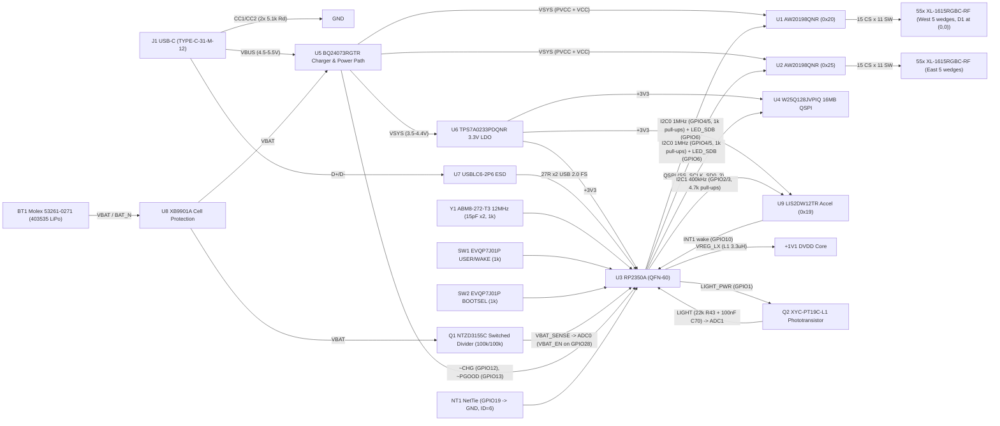

# Architecture and Part Audit Index: Sunflower `s2-110-usbc` (Rev S3C)

Phase 1 block diagram, GPIO allocation, and datasheet audit mapping for `hw/sunflower/s2-110-usbc/`.

## System Block Diagram

## Schematic Sheet Mapping

| Sheet | File | Functional Blocks |
|---|---|---|
| Top | `sunflower.kicad_sch` | Hierarchical root connecting `Power`, `MCU`, `Driver 1 and matrix`, and `Driver 2 and matrix` |
| Power | `power.kicad_sch` | `J1` USB-C + `R1/R2` CC pull-downs + `U7` ESD; `U5` `BQ24073` charger/power-path (`TP1` `VSYS`); `U6` `TPS7A0233` `3.3 V` LDO (`TP2` `+3V3`); `BT1` PicoBlade + `U8` `XB9901A` protection (`TP3` `VBAT`, isolated `BAT_N`); `Q1` switched `VBAT` divider |
| MCU | `mcu.kicad_sch` | `U3` `RP2350A` + `L1` `3.3 µH` core buck (`TP4` `+1V1`) + `U4` `W25Q128JVPIQ` flash + `Y1` `12 MHz` crystal; `U9` `LIS2DW12TR` accelerometer; `SW1`/`SW2` peg-less side buttons; `I2C0` `1 kΩ` pull-ups + `LED_SDB` pull-down; `Q2` `XYC-PT19C-L1` top-rim light sensor (`R43 = 22 kΩ`, `C70 = 100 nF`); `NT1` board-ID strap (`ID = 6`); SWD & bring-up test pads (`TP5`–`TP8`, `TP11`–`TP16`) |
| Driver 1 | `matrix1.kicad_sch` | `U1` `AW20198QNR` (`0x20`, `AD1 = AD0 = GND`, `R30 = 30 kΩ`, `C30 = 22 µF`, `C31/C34 = 1 µF`, `C32/C33 = 100 nF`) driving `55` `XL-1615RGBC-RF` LEDs (`CS1..15 × SW1..11`, `CS16..18` `NC`, including `D1` at `(0, 0)`) |
| Driver 2 | `matrix2.kicad_sch` | `U2` `AW20198QNR` (`0x25`, `AD1 = AD0 = VSYS`, `R33 = 30 kΩ`, `C40 = 22 µF`, `C41/C44 = 1 µF`, `C42/C43 = 100 nF`) driving `55` `XL-1615RGBC-RF` LEDs (`CS1..15 × SW1..11`, `CS16..18` `NC`) |

## `RP2350A` (`U3`) Pin & GPIO Allocation (`s2-110-usbc`)

| Pin / GPIO | Net | Direction / Function | External Circuit & Sleep State |
|---|---|---|---|
| `GPIO0` | NC | Unused | `no_connect` |
| `GPIO1` | `/MCU/LIGHT_PWR` | Out: `Q2` collector supply | `0 V` in sleep (`0 µA`); driven high `10 ms` during `ADC1` sample (`≤ 150 µA`) |
| `GPIO2`, `GPIO3` | `/MCU/ACC_SDA`, `/MCU/ACC_SCL` | `I2C1` `400 kHz` to `U9` (`0x19`) | `4.7 kΩ` pull-ups (`R20`, `R19`) to `+3V3`; clear RP2350 `§9.7` latched pull-downs before sleep |
| `GPIO4`, `GPIO5` | `I2C_SDA`, `I2C_SCL` | `I2C0` `1 MHz` to `U1` (`0x20`), `U2` (`0x25`), `TP11`, `TP12` | `1 kΩ` pull-ups (`R21`, `R22`) to `+3V3`, `12 mA` pad drive; clear latched pull-downs before sleep |
| `GPIO6` | `LED_SDB` | Out: shared `AW20198` `EN` (active-high) | `100 kΩ` pull-down (`R31`) + `100 nF` (`C35`) to `GND`; low in sleep (`1.3 µA`/driver typ) |
| `GPIO7`–`GPIO9` | NC | Unused (no direct-drive LED on `s2-110-usbc`) | `no_connect` (`D1` at `(0, 0)` is matrix-driven on `U1`) |
| `GPIO10` | `/MCU/ACC_INT` | In: `U9` `INT1` motion wake (`PWRUP`) | Push-pull active-high/low from `U9`; clear pad pull-down if configured active-low |
| `GPIO11` | `/MCU/BTN` | In: `SW1` `USER/WAKE` (`PWRUP`) | `1 kΩ` series (`R18`) to `SW1` → `GND`; internal pull-up enabled |
| `GPIO12`, `GPIO13` | `CHG`, `PGOOD` | In: `U5` `~{CHG}`, `~{PGOOD}` open-drain | `100 kΩ` pull-ups (`R7`, `R6`) to `+3V3`; clear latched pull-downs before sleep |
| `GPIO14`–`GPIO18` | NC | Unused | `no_connect` |
| `GPIO19` | `/MCU/BOARD_ID0` | In: hardware ID bit 0 (`0`) | Tied to `GND` via copper net-tie `NT1`; disable internal pull-up after boot read (`ID = 6 = 0b110`) |
| `GPIO20`, `GPIO21` | NC (`BOARD_ID1`, `BOARD_ID2`) | In: hardware ID bits 1–2 (`1`, `1`) | Open (`no_connect`); read high via internal pull-up at boot, then disable pull-up |
| `GPIO22`, `GPIO23` | NC | Unused | `no_connect` |
| `GPIO24`, `GPIO25` | `/MCU/UART_TX`, `/MCU/UART_RX` | Bring-up `UART1` | Routed to `B.Cu` test pads `TP14`, `TP15` |
| `GPIO26/ADC0` | `VBAT_SENSE` | Analog in: `VBAT / 2` | `100 kΩ / 100 kΩ` (`R11/R12`) + `100 nF` (`C7`), high-side switched by `Q1` |
| `GPIO27/ADC1` | `/MCU/LIGHT` | Analog in: `Q2` emitter | `22 kΩ` (`R43`) + `100 nF` (`C70`) to `GND` (`τ = 2.2 ms`) |
| `GPIO28/ADC2` | `VBAT_EN` | Out: `Q1` N-FET gate enable | `100 kΩ` pull-down (`R9`) to `GND` (`0 µA` off); **variant delta vs main board (`GPIO14`)** |
| `GPIO29/ADC3` | `/MCU/GPIO29_TP` | Spare analog / GPIO test pad | Routed to `B.Cu` test pad `TP16` |
| `~{QSPI_SS}` + `QSPI` | `/MCU/QSPI_*` | `U4` `W25Q128JVPIQ` + `SW2` `BOOTSEL` | `SW2` via `1 kΩ` (`R16`) to `GND` |

## Complete BOM-to-Audit Cross-Reference (`36` BOM lines, `34` unique LCSC parts)

| Ref(s) | Value / MPN | LCSC | Audit File & `s2-110-usbc` Notes |
|---|---|---|---|
| `BT1` | `Molex 53261-0271` | `C177225` | `design/parts/parallelogram-io.md` §2 (`molex-53261-0271.pdf`; `1.0 A`, `3.20 mm` height, `Pin 1 = VBAT`, `Pin 2 = BAT_N`, `MP = GND`) |
| `J1` | `TYPE-C-31-M-12` | `C165948` | `design/parts/usb.md` (`type-c-31-m-12.pdf`; 16-pin USB-C with 4 TH shell stakes + 2 NPTH pegs; spiral steers `D1..D110` round all 6 holes) |
| `U1`, `U2` | `AW20198QNR` | `C5137654` | `design/parts/drivers-aw20198.md` (`aw20198qnr.pdf`; `15 CS × 11 SW` used per chip = `55` LEDs, `CS16..18` `NC`, `R_EXT = 30 kΩ` → `13.33 mA` peak, `200 mA` slot peak/chip, `354.2 mA` all-white total) |
| `D1`–`D110` | `XL-1615RGBC-RF` | `C965840` | `design/parts/leds-xl1615.md` (`xl-1615rgbc-rf.pdf`; `Pin 2 = Anode`, `1 = R`, `3 = G`, `4 = B`; `+180°` EasyEDA CPL offset) |
| `U3`, `L1`, `Y1` | `RP2350A`, `AOTA-B201610S3R3-101-T`, `ABM8-272-T3` | `C42411118`, `C42411119`, `C20625731` | `design/parts/rp2350-core.md` + `.claude/skills/pcb-design/chips/rp2350.md` (`rp2350.pdf`, `aota-b201610.pdf`, `abm8-272.pdf`; `L1` now `1,526` in JLC stock) |
| `U4` | `W25Q128JVPIQ` | `C190862` | `design/parts/flash.md` (`w25q128jv.pdf`; WSON-8 `NoEPCopper`, `10 µA` standby included in `81.8 µA` sleep budget) |
| `U5` | `BQ24073RGTR` | `C15220` | `design/parts/charger.md` (`bq24075.pdf`; `USB500`, `ICHG = 297 mA` via `R4 = 3.0 kΩ`, `ILIM = 424 mA` via `R5 = 3.6 kΩ`, `TS = 10 kΩ` `R3`) |
| `U6` | `TPS7A0233PDQNR` | `C2860046` | `design/parts/ldo.md` (`tps7a02.pdf`; `200 mA` X2SON-4, fed from `VSYS`, `~0.6 µA` sleep ground current) |
| `U7` | `USBLC6-2P6` | `C15999` | `design/parts/usb.md` (`usblc6-2p6.pdf`; SOT-666 ESD on `D+/D−/VBUS`) |
| `U8` | `XB9901A` | `C669687` | `design/parts/protection.md` (`xb9901a.pdf`; `R8 = 100 Ω`, `C6 = 100 nF` to isolated `BAT_N` on pins `4, 5, EP`) |
| `U9` | `LIS2DW12TR` | `C189624` | `design/parts/accel.md` (`lis2dw12.pdf`; `0x19` on `I2C1`, `C25/C27 = 100 nF` + `C26 = 4.7 µF`) |
| `Q1` | `NTZD3155CT1G` | `C236117` | `design/parts/q1-divider-switch.md` (`ntzd3155c.pdf`; `N` gate on `GPIO28` `VBAT_EN` on `s2-110-usbc`) |
| `Q2`, `R43`, `C70` | `XYC-PT19C-L1`, `22 kΩ` (`0402WGF2202TCE`), `100 nF` | `C2693594`, `C25768`, `C1525` | `design/parts/drivers-aw20198.md` + `design/parts/light-sensor.md` (`xyc-pt19c-l1.pdf`; `IPH = 30 µA` typ at `100 lx` → `0.66 V` across `22 kΩ`, saturates `~440 lx` at `2.9 V` vs `~1000 lx` for drop-in `ALS-PT19`) |
| `SW1`, `SW2` | `EVQP7J01P` | `C2828254` | `design/parts/drivers-aw20198.md` (`evqp7j01p.pdf`; peg-less side tactile switches, `1.6 N`) |
| `C1`–`C44`, `R1`–`R33` | MLCCs (`C0G`, `X5R`, `X7R`) & `1%` `0402` resistors | `C52923`, `C86295`, `C19702`, `C1525`, `C23733`, `C1548`, `C25905`, `C25744`, `C25784`, `C25891`, `C25741`, `C25076`, `C25105`, `C25100`, `C11702`, `C25900`, `C25776` | `design/parts/passives.md` (voltage margin `≥ 2×` on `10 V`/`16 V`/`25 V`/`50 V` MLCCs; `22 µF` `0603` `10 V` X5R derated `~50%` to `~11 µF` effective at `4.4 V` `VSYS`) |
